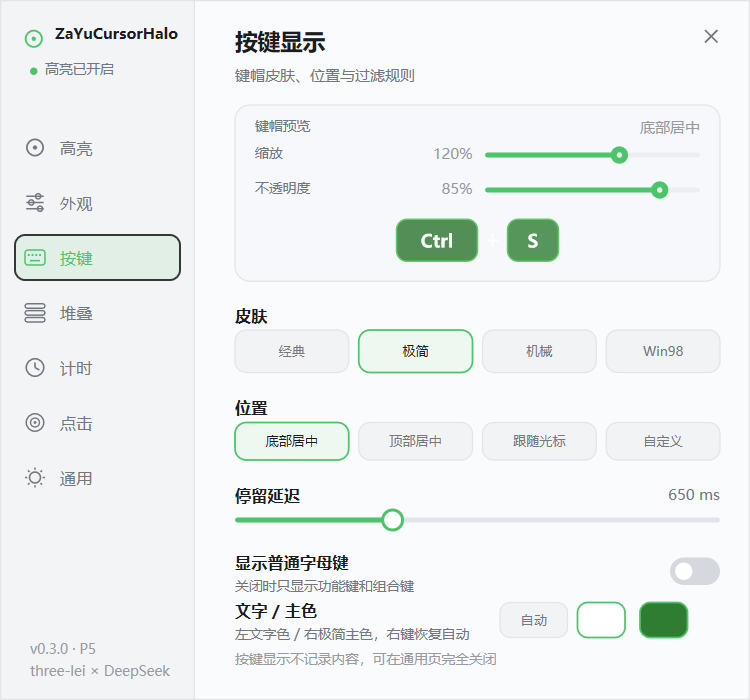
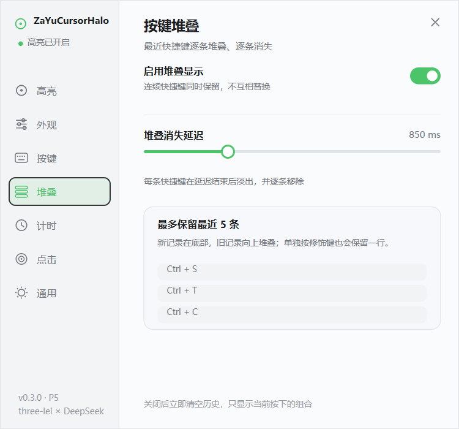

# ZaYuCursorHalo

**专为 Windows 7 优化的原生鼠标工具。**

鼠标高亮、按键显示、浮动计时器，在 Win7 上也能流畅使用。

无需安装，无需运行库，无需管理员权限。

> v0.3.0 · MIT License · Windows 7 SP1 / 8 / 10 / 11





## 下载 / 快速试用

从 GitHub Releases 下载 `ZaYuCursorHalo-v0.3.0-win7-x86.zip`，解压后直接运行
`ZaYuCursorHalo.exe`。无需安装、无需 .NET/Electron/WebView2、无需 VC++ 运行库，
普通用户权限即可运行。

也可以从源码构建：

```bat
scripts\build-win7-x86.cmd
```

生成 `dist\ZaYuCursorHalo.exe`。

## 功能

- 鼠标光环：光环、双环、准星、光点四种样式；大小、透明度、颜色可调。
- 全局快捷键：默认 `Ctrl + Alt + H`，可重新录制。
- 按键显示：以实际按下的键为准，只保留一条不可变的组合键快照；普通字母打字不会重建或复活上一条快捷键。
- 输入法：IME 按键结束当前提示，但保留原延迟和淡出，不会卡在半透明状态。
- 按键大小：70%–150% 缩放；按键不透明度：20%–100%，可透视下方内容。
- 按键皮肤：经典 / 极简 / 机械 / Win98 四种；极简可设置一个主色，边框自动推导深浅。
- 自定义位置：进入定位模式后显示半透明 `Ctrl + S` 残影跟随鼠标，帮助预览最终效果。
- 按键堆叠：保留最近 5 条快捷键，独立消失延迟，逐条淡入/滑出。
- 浮动计时器：正计时、倒计时、自定义 1–99 分钟、分段、拖动位置保存。
- 鼠标拖尾：移动时绘制尾部收细、渐隐的延迟曲线，停止约 320 ms 后消失。
- 点击反馈：左右键波纹，10 个点击音效预设，0–100% 音量，支持导入 WAV/MP3（MP3 本地解码为 WAV）。
- 设置窗口：普通任务栏窗口，可从任务栏或 Alt+Tab 切回；打开设置时光环、按键、拖尾和点击反馈仍实时生效。
- 计时器：时间码使用较小字号的 DSEG7，并在胶囊内居中；窗口尺寸变化时保持视觉中心不跳动。
- 单实例运行，普通用户权限，不安装服务或驱动。

## 键盘操作

- 设置窗口：`Tab` / `Shift+Tab` 移动焦点；导航项用方向键 + `Enter`/`Space` 切页。
- 滑块：方向键、`Home`/`End`、`PgUp`/`PgDn`。
- 调色盘：`Tab` 在 SV、色相、HEX、取消、完成间循环；`Enter` 完成，`Esc` 取消。
- 托盘面板：方向键 / `Tab` 移动，`Enter`/`Space` 执行，`Esc` 关闭。
- 按键显示由独立低级键盘钩子采集，只做屏幕绘制，不记录按键；设置打开时暂停，关闭后恢复。

## 配置

配置自动保存到 `%APPDATA%\ZaYuCursorHalo\config.ini`。

主要字段：

```ini
[general]
enabled=1
show_keys=1

[highlight]
radius=36
opacity=95
color=5B8DFF
style=ring

[keys]
skin=minimal
position=bottom
delay_ms=650
scale_percent=100
opacity_percent=100
show_letter_keys=0
stack=0
stack_delay_ms=650
style_color=auto
text_color=auto

[timer]
enabled=0
mode=up
countdown_minutes=5

[trail]
enabled=0

[effects]
click_ripple=0
click_sound=0
volume=100
```

## 构建与 Win7 门禁

```bat
scripts\build-win7-x86.cmd
```

构建脚本会自动运行 `scripts/check-win7-compat.ps1`，检查：

- x86 架构；
- `SUBSYSTEM` 版本 ≤ 6.01；
- 无 Win8+ API / API set / UCRT / VC++ 运行库静态导入；
- 无 `MAGNIFICATION.dll` 等已知 Win7 不兼容依赖。

检查失败会拒绝构建。

## Win7 兼容状态

- 当前版本：v0.3.0
- 构建门禁：PASS（x86、subsystem 6.01、无 Win8+ 静态导入）
- 当前环境在 Windows 11 上通过构建、门禁和冒烟测试
- 最新构建仍建议在真实 Windows 7 SP1 上完成一次启动回归

发布前注意：

- 构建门禁 PASS 只能证明 PE 结构和静态导入没有明显 Win8+ 依赖，不能替代真机启动。
- 发布前在干净 Windows 7 SP1 x86/x64 上解压运行，确认无“无法定位程序输入点”/缺少 DLL 弹窗。
- 再走一遍托盘、设置、按键、计时器、拖尾、点击音效、Aero/Basic 主题和 125%/150% DPI。
- 真机结果记录在 Release Notes；未实测不要标记为“绝对兼容”。

真机清单：[docs/WIN7_RELEASE_AUDIT.md](docs/WIN7_RELEASE_AUDIT.md)

## 文档

- [Win7 发布审计与 API 清单](docs/WIN7_RELEASE_AUDIT.md)
- [Win7 兼容规范与发布清单](docs/win7-compatibility.md)
- [GitHub 发布步骤](docs/GITHUB_PUBLISH.md)
- [按键显示与皮肤](docs/p3-key-visualizer.md)
- [浮动计时器](docs/p4-timer.md)
- [高亮层 Z 序](docs/p4-overlay-zorder.md)
- [鼠标拖尾](docs/p4-trail.md)
- [应用图标](docs/p4-icon.md)
- [点击反馈与光环样式](docs/p5-interaction.md)
- [技术路线](docs/technical-roadmap.md)
- [构建工具链](docs/toolchain-setup.md)

## 许可证

- 项目：[MIT](LICENSE)
- 第三方组件：[THIRD_PARTY_NOTICES.md](THIRD_PARTY_NOTICES.md)
  - minimp3：CC0 1.0
  - DSEG7 Modern 字体：SIL OFL 1.1
- 变更记录：[CHANGELOG.md](CHANGELOG.md)

---

制作：**three-lei × DeepSeek**
