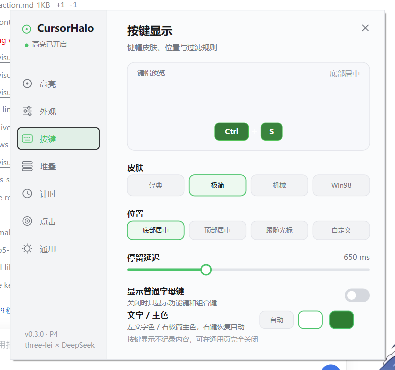
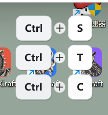

# CursorHalo（暂定名）

一个面向 **Windows 7 SP1 及以上**的原生桌面高亮工具：托盘常驻，鼠标周围显示低延迟光环，在屏幕底部显示当前按键组合，并在桌面浮动显示可拖动的录屏计时器。

**当前版本：v0.3.0。功能已完成，构建门禁 PASS（x86、subsystem 6.01、无 Win8+ 静态导入）。当前环境只在 Windows 11 上跑过冒烟测试；最新这一版尚未在真实 Windows 7 SP1 上完成回归，发布前请按 [Win7 发布审计](docs/WIN7_RELEASE_AUDIT.md) 的真机清单逐项确认。**

> 制作者：**three-lei × DeepSeek** · 版本 **0.3.0** · MIT License





> **项目硬约束：Windows 7 SP1 x86 是第一目标。任何新功能都必须先通过 Win7 兼容性评估和构建门禁，详见 [docs/win7-compatibility.md](docs/win7-compatibility.md)。**

## 下载 / 快速试用

从 GitHub Releases 下载 `CursorHalo-v0.3.0-win7-x86.zip`，解压后直接运行
`CursorHalo.exe`。无需安装、无需 .NET/Electron/WebView2、无需 VC++ 运行库，
普通用户权限即可运行。

也可以从源码构建：

```bat
scripts\build-win7-x86.cmd
```

生成 `dist\CursorHalo.exe`。

- 启动后光环跟随鼠标。
- 光环高于 WPS 等应用的置顶弹层，并保持在任务栏上方（包括托盘图标区域），点击任务栏也不会被压到底层。
- 左键单击托盘图标：开关高亮。
- 右键托盘图标：打开自绘面板，可直接开关“启用高亮 / 显示按键 / 浮动计时器”，以及进入设置或退出。
- 全局快捷键：默认 `Ctrl + Alt + H`，可在“设置 → 通用 → 全局快捷键”点击胶囊重新录制。
- 主题：通用页可切换“跟随系统 / 浅色 / 深色”；跟随系统在 Win7 上回退浅色。
- 按键显示：在屏幕底部显示当前组合键（如 `Ctrl + S`），键帽间带 `+` 分隔；默认只显示功能键和带修饰键的组合。关闭字母键后，Backspace、Enter、Delete、Tab 等编辑/功能键仍会显示。
- 按键设置页：左侧“按键”可调皮肤（经典/极简/机械/Win98）、位置（底部/顶部/跟随光标/自定义屏幕位置）、停留延迟（0–2000 ms）、普通字母键显示、文字颜色和极简主色（左色块为文字色，右色块为主色，边框自动推导；右键主色恢复自动）；侧边栏“堆叠”页可开启堆叠显示，设置独立的消失延迟；最近快捷键带淡入/滑入和淡出/滑出动画，逐条出现、逐条消失。
- 设置窗口是普通任务栏窗口，可以从任务栏或 Alt+Tab 切回；关闭后从任务栏移除。
- 自定义位置：选择后设置窗口隐藏，示例键帽跟随鼠标，单击确认，Esc/右键取消。
- 浮动计时器：桌面置顶显示 `[握把] [▶] [■] [分段] HH:MM:SS`，可右键切换正计时/倒计时；按住左侧六点握把拖动，位置自动保存，并限制在任务栏上方的工作区，不覆盖托盘图标。
- ▶ 开始/继续，■ 暂停，暂停时再点 ■ 归零；数字固定字宽不抖动，逐像素 alpha 圆角，GDI+ 抗锯齿图标。
- 计时器设置：左侧“计时”页可启用/隐藏、启动时自动开始、显示小时位、停止时归零和手动重置。
- 鼠标拖尾：托盘面板可开关；移动时在指针后方绘制一条尾部收细、带渐隐和光晕的延迟曲线，停止移动约 320 ms 后消失；不使用系统指针轨迹，不安装鼠标钩子，点击直接穿透。
- 点击反馈：可选点击波纹和左右键不同音高的短音效；设置侧边栏“点击”页可分别设置左键/右键波纹颜色（HSV/HEX）、5 组音效预设，或导入自定义 WAV/MP3（MP3 内置解码为 WAV，最长 15 秒）。
- 计时器：支持正计时、倒计时（右键选择 5–60 分钟或自定义 1–99 分钟）和分段打点，显示最近一段时长。
- 光环样式：光环、双环、准星、光点四种，设置页即时切换。
- 首次启动会自动打开一次托盘面板；版本号和署名显示在面板标题区。
- 设置窗口和托盘面板打开时，鼠标高亮光圈仍然显示，并且保持点击穿透。

设置窗口支持 1:1 实际尺寸预览、光环直径、不透明度、5 种预设颜色、自定义 HSV 调色盘与 6 位 HEX 输入、4 种光环样式、可录制全局快捷键、主题、按键显示、浮动计时器、开机启动；配置自动保存到 `%APPDATA%\CursorHalo\config.ini`。按键显示总开关为 `show_keys=1|0`，外观与规则保存在 `[keys]`；计时器行为保存在 `[timer]`（`enabled`、`auto_start`、`show_hours`、`reset_on_stop`、`mode`、`countdown_minutes`、`x`、`y`、`has_position`）；鼠标拖尾保存在 `[trail] enabled=0|1`，默认关闭；点击波纹/音效保存在 `[effects]`，默认关闭；光环样式保存在 `[highlight] style=ring|double|crosshair|dot`。设置窗口和托盘面板打开时，实际光环仍然显示并保持点击穿透；计时器不受设置窗口开关影响。

## 键盘操作

- 设置窗口：`Tab` / `Shift+Tab` 移动焦点；导航项用方向键 + `Enter`/`Space` 切页；滑块用方向键、`Home`/`End`、`PgUp`/`PgDn`；开关、主题、色块、快捷键胶囊、关闭按钮用 `Enter`/`Space`。
- 调色盘：`Tab` 在 SV、色相、HEX、取消、完成间循环；SV/色相支持方向键；`Enter` 完成，`Esc` 取消。
- 托盘面板：方向键 / `Tab` 移动焦点，`Enter`/`Space` 执行，`Esc` 关闭。
- `Esc` 先关闭调色盘/面板等弹层，再关闭设置；关闭设置不会退出进程。
- 按键显示由独立的低级键盘钩子采集，只做屏幕绘制，不记录按键；设置打开时自动暂停，关闭后恢复。

## 构建与 Win7 门禁

```bat
scripts\build-win7-x86.cmd
```

构建脚本会自动运行 `scripts/check-win7-compat.ps1`，检查：

- x86 架构；
- `SUBSYSTEM` 版本 ≤ 6.01；
- 无 Win8+ API / API set / UCRT / VC++ 运行库静态导入；
- 无 `MAGNIFICATION.dll` 等已知 Win7 不兼容依赖。

检查失败会拒绝构建。手动检查：

```powershell
powershell -NoProfile -ExecutionPolicy Bypass -File scripts\check-win7-compat.ps1 -Exe dist\CursorHalo.exe
```

## Win7 发布前必读

- 构建门禁 PASS 只能证明 PE 结构和静态导入没有明显 Win8+ 依赖，不能替代真机启动。
- 发布前在一台干净的 Windows 7 SP1 x86/x64 上解压运行，确认无
  “无法定位程序输入点”/缺少 DLL 弹窗，再走一遍托盘、设置、按键、计时器、
  拖尾、点击音效、Aero/Basic 主题和 125%/150% DPI。
- 真机结果请记录在 Release Notes；未实测不要标记为“绝对兼容”。

## 文档

- Win7 发布审计与 API 清单：[docs/WIN7_RELEASE_AUDIT.md](docs/WIN7_RELEASE_AUDIT.md)
- GitHub 发布步骤：[docs/GITHUB_PUBLISH.md](docs/GITHUB_PUBLISH.md)
- Win7 兼容规范与发布清单：[docs/win7-compatibility.md](docs/win7-compatibility.md)
- 技术路线：[docs/technical-roadmap.md](docs/technical-roadmap.md)
- P0 实测结果：[docs/p0-results.md](docs/p0-results.md)
- P1 设置、托盘、主题与键盘结果：[docs/p1-results.md](docs/p1-results.md)
- P3 按键可视化结果：[docs/p3-key-visualizer.md](docs/p3-key-visualizer.md)
- P4 浮动计时器结果：[docs/p4-timer.md](docs/p4-timer.md)
- P4 高亮层 Z 序修正（WPS 等置顶弹层）：[docs/p4-overlay-zorder.md](docs/p4-overlay-zorder.md)
- P4 鼠标延迟拖尾：[docs/p4-trail.md](docs/p4-trail.md)
- P4 应用图标重绘：[docs/p4-icon.md](docs/p4-icon.md)
- P5 点击反馈/倒计时/光环样式：[docs/p5-interaction.md](docs/p5-interaction.md)
- Win7 构建工具链：[docs/toolchain-setup.md](docs/toolchain-setup.md)
- 工程原则：原生单 exe、无 .NET/Electron/WebView2 依赖、无需管理员权限、离线运行
- 许可证：[MIT](LICENSE)
- 第三方组件：[THIRD_PARTY_NOTICES.md](THIRD_PARTY_NOTICES.md)
- 变更记录：[CHANGELOG.md](CHANGELOG.md)
