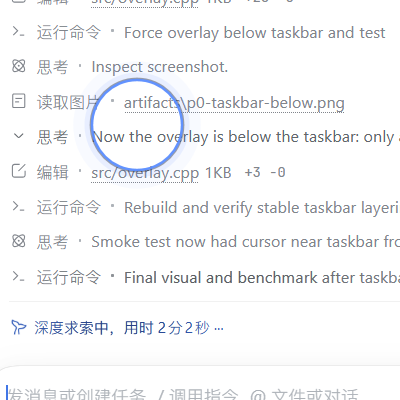

# P0 技术穿刺结果

> 后续修正（P4+）：高亮层改为普通 topmost，高于 WPS 等应用的 `WS_EX_TOPMOST` 弹层，同时也保持在任务栏上方；不再插入任务栏下方或靠近任务栏时隐藏。本文“插入 Shell_TrayWnd 之后”描述的是 P0 历史行为。
>
> 日期：2026-11-19  
> 结论：**Go**。Win32/D2D 分层窗口、静态光环缓存、DWM 节拍、托盘与热键路线均已在 Win11 验证通过。真实 Win7 运行时仍待后续环境验证。

## 交付物

- 可执行文件：[`dist/ZaYuCursorHalo.exe`](../dist/ZaYuCursorHalo.exe)
- 实际桌面截图（165 Hz、125% 缩放、物理 2560×1440）：  
  
- 任务栏下方行为截图：  
  
- 离屏渲染表面（首次绘制缓存，供验证绘制质量）：[`p0-frame-surface.png`](../artifacts/p0-frame-surface.png)
- 测试原始记录：
  - [`p0-bench-dwm.txt`](../artifacts/p0-bench-dwm.txt)
  - [`p0-bench-timer.txt`](../artifacts/p0-bench-timer.txt)
  - [`p0-smoke.log`](../artifacts/p0-smoke.log)

## 已实现

- 原生 C++17、Win32、Direct2D 1.0 软件 WIC 表面。
- `WS_EX_LAYERED | WS_EX_TRANSPARENT | WS_EX_TOOLWINDOW | WS_EX_TOPMOST | WS_EX_NOACTIVATE` 叠加窗口。
- 小尺寸光环窗口，中心对准光标；默认半径 36 DIP，带柔和光晕、深色描边和内高光。
- **光环只绘制一次并缓存**；纯跟随阶段用 `SetWindowPos` 移动缓存后的分层窗口，不重复 D2D 绘制。
- 显示前/后把自己插到 `Shell_TrayWnd` 之后，叠加层从第一帧起就在任务栏下方；点击任务栏不会再产生层级跳变。
- `WH_MOUSE_LL` 独立线程只负责 `SetEvent`，不阻塞输入。
- `DwmFlush` 按 DWM 合成节拍限帧；无显示器刷新时回退高精度 waitable timer。
- 静止约 350 ms 后完全停止帧循环；无轮询、无后台重绘。
- 托盘：左键开关，右键原生菜单（暂停/开启、退出），`Shell_NotifyIconGetRect` 验证图标成功注册。
- 全局快捷键 `Ctrl+Alt+H`，可真实按键触发。
- 单实例互斥体、`WM_CLOSE` 优雅退出。
- CLI 诊断参数：
  - `--benchmark=<秒>`：自动退出并写统计。
  - `--stats=<路径>`。
  - `--pacer=dwm|timer`。
  - `--radius=<16..120>`。
  - `--dump-frame=<png>`：导出离屏表面。

## Win11 实测

环境：Windows 11 26200；165.025 Hz；物理 2560×1440；显示缩放 125%；20 个逻辑处理器；v141 14.16 + SDK 19041 x86 构建。

| 项目 | 结果 |
|---|---|
| 跟随/可见性 | 叠加窗口可见，位置随光标移动；截图确认光环显示 |
| 前后台焦点 | 启动、移动、热键切换后前台始终是 Chrome，未被抢焦点 |
| 点击穿透 | 在光环覆盖点 `WindowFromPoint` 返回底层窗口（Chrome 子窗口或 `Shell_TrayWnd`），从未返回叠加层 |
| 热键 | 真实 `Ctrl+Alt+H` 注入：隐藏→显示均成功 |
| 托盘 | `Shell_NotifyIconGetRect` 返回成功，托盘图标矩形有效 |
| 静止 CPU | **0.00% 单核**（4 秒采样） |
| 工作集 | 约 19.0 MB |
| 任务栏层级 | 启动后即位于任务栏下方；点击任务栏无层级跳变 |
| 优雅退出 | `WM_CLOSE` → 7 ms 内退出，退出码 0 |
| 文件大小 | 339,968 bytes（约 332 KB） |

### 帧率与 CPU（8.5 秒、240 Hz 光标输入）

| 模式 | 帧数 | 实测 FPS | interval p50 / p99 | 晚于 1.5× 目标 | CPU（单核） |
|---|---:|---:|---:|---:|---:|
| **DWM 节拍** | 1399 | 164.55 / 165.02 | 6.058 / 6.411 ms | 2 帧 | **4.93%** |
| 纯定时器 | 1397 | 164.41 / 165.02 | 6.061 / 6.405 ms | 3 帧 | 25.36% |

DWM 模式下：

- `DwmFlush` 实际等待 p50 5.748 ms，p99 5.973 ms。
- 缓存后 `render_ms` 为 0；仅窗口移动，`SetWindowPos` 耗时 p50 0.293 ms，p99 0.503 ms。
- 最大帧间隔 24.1 ms（偶发调度抖动），p99 6.411 ms，约 1.06× 刷新周期。

> 纯定时器虽然帧间隔数字接近，但 CPU 是 DWM 模式的 3.7 倍，因此默认固定为 DWM 节拍。

## PE / 兼容性检查

- `machine x86`，Linker 14.16，`subsystem version 6.01`，`operating system version 6.01`。
- 导入表仅：
  `KERNEL32.dll`、`USER32.dll`、`GDI32.dll`、`ole32.dll`、`SHELL32.dll`、`d2d1.dll`、`dwmapi.dll`。
- 无 `VCRUNTIME` / `MSVCP` / `ucrtbase` / `api-ms-win-*` 动态依赖，静态 CRT 生效。
- 无 `GetDpiForWindow`、`SetProcessDpiAwarenessContext` 等 Win8+ 静态 API。
- 自定义 manifest 同时包含 Win7 的 `dpiAware=true` 和现代系统的 `PerMonitorV2`。
- `GetDpiForMonitor` 是运行时动态加载 `shcore.dll`，Win7 上自动回退系统 DPI。

## 任务栏遮挡（系统限制）

光环移入底部任务栏区域时，下半环会被任务栏盖住。这不是本程序的 z-order 设置错误：

- 任务栏不是普通的 `WS_EX_TOPMOST` 窗口，而是由 shell 保留在更高层级的合成区域中。
- 普通应用的 `WS_EX_TOPMOST` 只保证在应用窗口层内尽可能靠前，不能保证盖过系统任务栏。
- Windows 7 会更进一步：当应用顶层窗口与任务栏重叠时，系统可能直接取消其 topmost 属性，防止应用伪装/覆盖任务栏。
- 本机 Win11 实测：`EnumWindows` 中叠加层排在 `Shell_TrayWnd` 之前，且试验中每次移动都重新调用 `HWND_TOPMOST`，像素结果完全不变；说明这不是重设 topmost 能解决的普通 z-order 问题。

**实现（2026-11-19）：始终保持在任务栏下方。**

- 显示前和 `ShowWindow` 后调用 `SetWindowPos(hwnd, Shell_TrayWnd, ..., SWP_NOACTIVATE)`，把自己插到任务栏之后。
- 启动第一帧起就在任务栏下方，点击任务栏任何内容也不会再发生“先浮到上面、再掉到下面”的跳变。
- 仍保留 `WS_EX_TOPMOST`，因此普通应用窗口依然盖不住光环。
- 鼠标移动到任务栏区域时光环会被任务栏遮住，这是接受的系统行为；不做贴边避让。
- 当前只处理主任务栏 `Shell_TrayWnd`；多显示器副任务栏留到 P1。
- 不采用非公开 z-band、UIAccess 或“任务栏子窗口”等方式强行覆盖任务栏：这些方案在 Win7 不可靠、需要额外权限/签名，违背本项目的轻量兼容契约。

## 尚未验证

- 真实 Windows 7 SP1 x86/x64：Aero 开/关、基本/经典主题、60 Hz、真实老 GPU。
- Win7 上 `DwmFlush` 与 `SetWindowPos` 移动分层窗口的实际观感；若 Win7 表现异常，可回退为“移动+内容”单次 `UpdateLayeredWindow`。
- 多显示器、负坐标、混合 DPI；副任务栏的“保持在下方”处理。
- 托盘菜单点击路径、单实例第二启动提示。
- 设置窗口、开机启动、配置持久化、UI 细节（属于 P1/P2）。
- 现代 UI 还没有开始做；当前托盘菜单仍是原生菜单，符合 P0 穿刺范围。

## 架构结论

P0 验证后，正式工程优先采用：

1. **光环内容缓存 + 纯位置移动**，而不是每帧重绘/ULW。
2. **DWM 节拍优先**，定时器仅作 Win7 无合成/异常回退。
3. **小表面、整数像素移动**，不做全屏透明窗口。
4. 下一步 P1 再做设置窗口、DPI/多屏、托盘面板与配置；不把这些 UI 复杂度混入已通过的核心。
