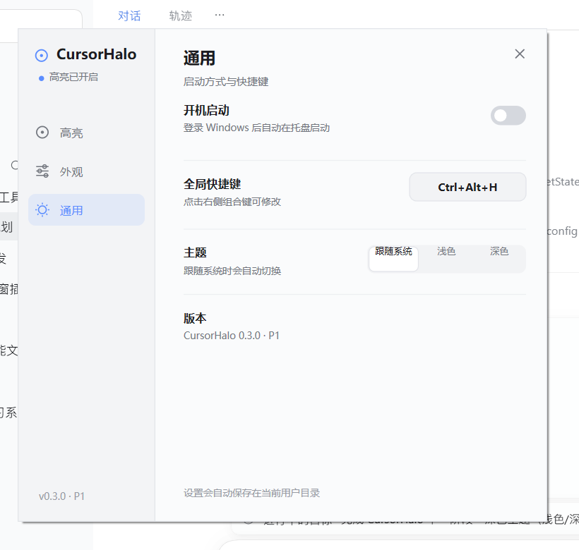
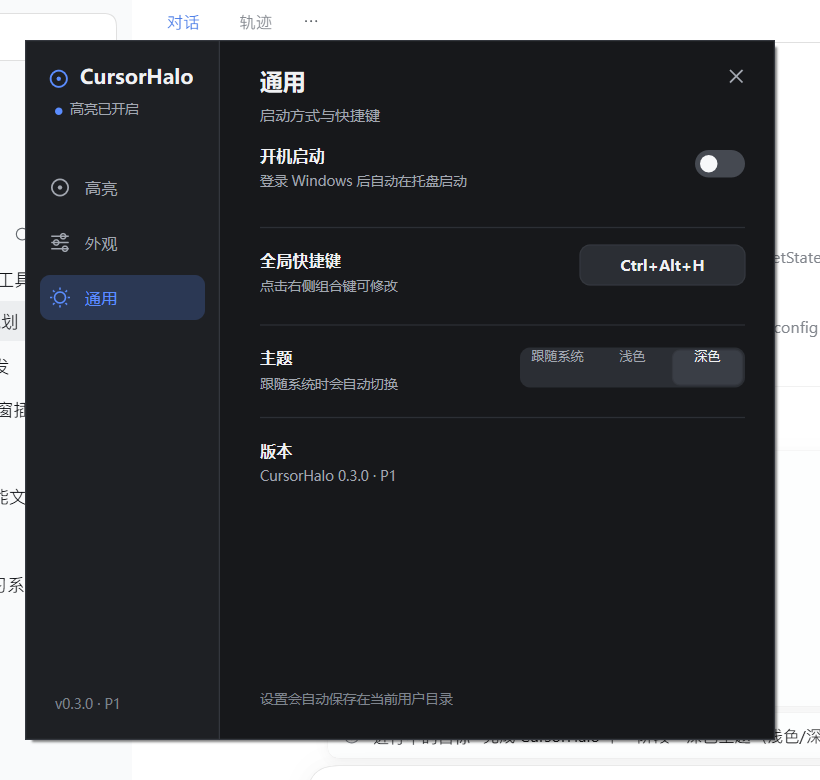
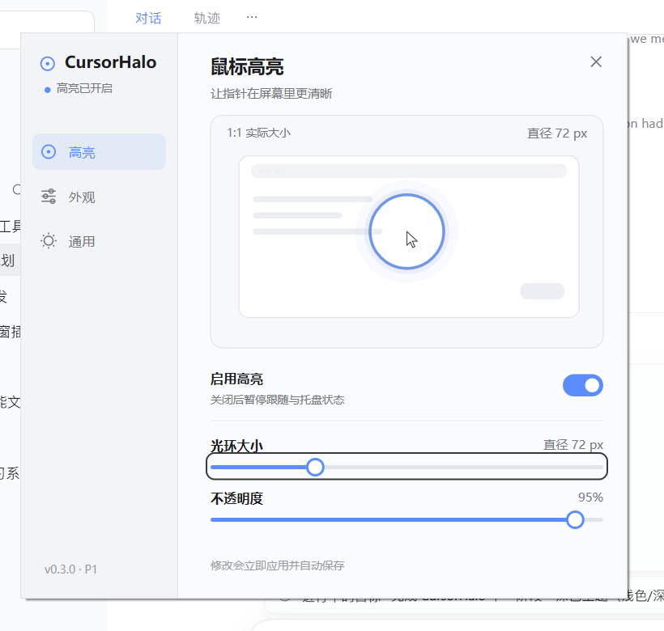
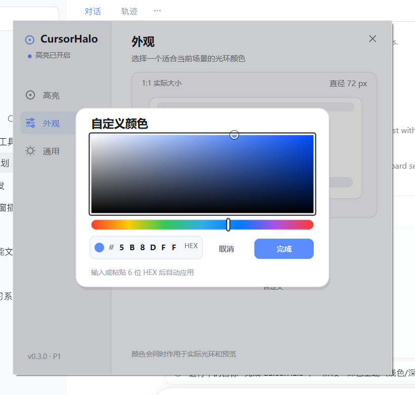
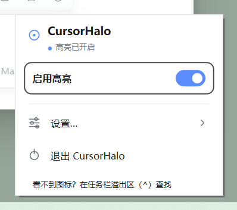

# P1 设置、托盘、主题与键盘阶段结果

> 注：按键可视化（P3）后来新增了“显示按键”设置和底部键帽层，见 [P3 结果](p3-key-visualizer.md)。本文截图保留 P1 阶段样式。  
> 后续 P4 面板改版：托盘面板底部快捷键、版本、署名和首次溢出提示已移除；版本与署名移到标题区。
>
> P4+ 高亮层级修正：不再固定插在任务栏下方，改为高于 WPS 等置顶弹层，并保持在任务栏上方。

> 日期：2026-11-19  
> 范围：自绘设置窗口、实时外观、1:1 实际尺寸预览、自定义 HSV 调色盘、HEX 输入、可录制全局快捷键、浅色/深色/跟随系统主题、设置/调色盘/托盘面板键盘导航、首次启动与托盘溢出提示、配置持久化、开机启动、自绘托盘面板。  
> 结论：Win11 交互、主题、键盘操作、首次引导、快捷键冲突与持久化通过；P0 跟随性能无回退；待 Win7 运行验证。

## 交付物

- 可执行文件：[`dist/CursorHalo.exe`](../dist/CursorHalo.exe)（0.3.0.0）
- 设置窗口：
  - [通用页（浅色）](../artifacts/p1-settings-general.png)、[通用页（深色）](../artifacts/p1-settings-general-dark.png)
  - [高亮页（浅色）](../artifacts/p1-settings-highlight.png)、[高亮页（深色）](../artifacts/p1-settings-highlight-dark.png)
  - [外观页（浅色）](../artifacts/p1-settings-appearance.png)
  - [调色盘（深色）](../artifacts/p1-settings-color-dark.png)
- 键盘导航：
  - [滑块焦点](../artifacts/p1-keyboard-slider.png)
  - [快捷键胶囊焦点](../artifacts/p1-keyboard-general.png)
  - [色块焦点](../artifacts/p1-keyboard-color.png)
  - [调色盘 SV 焦点](../artifacts/p1-settings-color-keyboard.png)
  - [托盘面板焦点](../artifacts/p1-keyboard-tray.png)
- 首次启动/溢出提示：
  - [浅色首次面板](../artifacts/first-run-panel.png)
  - [深色首次面板](../artifacts/first-run-panel-dark.png)
- 自定义颜色：[调色盘](../artifacts/p1-settings-color-picker.png)、[HEX 输入](../artifacts/p1-settings-hex-typed.png)、[粘贴 HEX](../artifacts/p1-settings-hex-paste.png)
- 1:1 大小预览：[默认 72 px](../artifacts/p1-settings-highlight.png)、[最大 160 px](../artifacts/p1-preview-1to1-max.png)、[最小 40 px](../artifacts/p1-preview-1to1-min.png)
- 快捷键录制：[录制中](../artifacts/p1-settings-hotkey-recording.png)、[冲突提示](../artifacts/p1-settings-hotkey-conflict.png)、[录制成功](../artifacts/p1-settings-hotkey-recorded.png)、[无修饰键提示](../artifacts/p1-settings-hotkey-invalid.png)
- 托盘面板：[开启状态](../artifacts/p1-tray-panel.png)、[暂停状态](../artifacts/p1-tray-panel-paused.png)、[深色](../artifacts/p1-tray-panel-dark.png)、[自定义快捷键同步](../artifacts/p1-tray-panel-hotkey.png)
- 性能回归：[`p1-bench-dwm.txt`](../artifacts/p1-bench-dwm.txt)
- 冒烟测试：[`p1-smoke.log`](../artifacts/p1-smoke.log)

## 新功能

### 主题系统

- 通用页新增“主题”分段控件：**跟随系统 / 浅色 / 深色**，点击或键盘方向键立即切换并写入配置。
- 配置保存为 `theme=system|light|dark`，默认 `system`。
- 跟随系统读取 `HKCU\Software\Microsoft\Windows\CurrentVersion\Themes\Personalize\AppsUseLightTheme`：
  - Win10/11 跟随应用主题。
  - Win7 没有该键时自动回退浅色，不调用 Win8+ API。
- 监听 `WM_SETTINGCHANGE` 的 `ImmersiveColorSet`；系统主题变化时，跟随模式会即时刷新设置窗口、调色盘、托盘面板和首次提示。
- 深色调色板覆盖：窗口/侧栏/卡片/边框/文字/分隔线/悬停/开关/滑轨/输入框/遮罩/阴影/焦点环。
- 颜色、光环、托盘图标本身不随主题改变；主题只影响界面中性色。
- 深色主题不是滤镜或覆盖层，而是逐控件调色，因此对比度和焦点环在亮/暗背景下都保持可见。

### 完整键盘导航

设置窗口：

- `Tab` / `Shift+Tab` 在当前页所有可交互控件间循环；顺序为导航项 → 页面控件 → 关闭按钮。
- 每个可聚焦控件有独立焦点环：导航项、开关、滑块轨道、色块、自定义色块、主题分段、快捷键胶囊、关闭按钮。
- 左侧导航获得焦点后，方向键移动焦点，`Enter` / `Space` 切页。
- 滑块获得焦点后：`←` / `→` 或 `↑` / `↓` 每次调整 1，`PgUp` / `PgDn` 调整 5，`Home` / `End` 到最小/最大。
- 开关使用 `Enter` / `Space` 切换。
- 色块使用左右方向键移动焦点并即时应用预设色；`Home` / `End` 到首/末色块；自定义色块用 `Enter` / `Space` 打开调色盘。
- 主题分段用左右方向键切换主题。
- 快捷键胶囊用 `Enter` / `Space` 进入录制。
- 关闭按钮用 `Enter` / `Space` 关闭窗口。
- 鼠标点击控件时也会同步焦点，鼠标与键盘状态一致。

调色盘：

- 打开后焦点进入 HEX 输入框，保持原有“直接输入/粘贴”的工作流。
- `Tab` / `Shift+Tab` 在 **SV 方块 → 色相条 → HEX 输入 → 取消 → 完成** 之间循环，焦点限制在模态内。
- SV 方块获得焦点后方向键调整饱和度/明度；色相条方向键调整色相；`Home` / `End` 跳到边界。
- HEX 输入框保持键盘编辑、`Ctrl+A`、`Ctrl+V` / `Shift+Insert` 粘贴。
- `Enter` 完成，`Esc` 取消；取消/完成都会把焦点还回“自定义”色块。
- 所有模态控件都有可见焦点环；点击 SV、色相、HEX、取消、完成也会同步焦点。

托盘面板：

- 打开后默认焦点在“启用高亮”，显示高对比焦点环。
- `↑` / `↓`、`←` / `→`、`Tab` / `Shift+Tab` 在三行间循环。
- `Enter` / `Space` 执行当前行；`Esc` 关闭面板。
- 鼠标悬停会同步焦点行，避免键盘焦点和鼠标位置分离。
- 首次启动自动打开面板时，焦点环直接显示，用户可以用键盘完成开关/设置/退出。

### 首次启动与托盘溢出提示

- 新增 `first_run` 配置，默认 `1`；旧配置没有该字段时按首次启动处理。
- 正常启动时，在消息循环开始后自动打开一次托盘面板：
  - 底部显示高对比文字提示：**“看不到图标？在任务栏溢出区（^）查找”**。
  - 面板本身带当前开关状态、快捷键和退出入口，用户可以直接操作。
  - `Esc`、点击外部关闭；关闭后配置写入 `first_run=0`，后续启动不再自动弹出。
- 没有依赖系统通知中心或托盘气球。Windows 通知被 Focus Assist/通知设置屏蔽时，提示仍然可见。
- `--settings`、`--tray-panel`、benchmark 模式不会触发首次提示；首次标记保留到下一次正常启动。
- 如果面板创建失败，`first_run` 不会被写成 0，下次启动会重试。
- 托盘面板正常打开时底部仍显示当前快捷键；只有首次提示那一次替换为溢出区提示。

### 设置窗口

- 原生 C++17 + Direct2D 1.0 Hwnd 渲染目标 + DirectWrite 1.0。
- 600×560 DIP 固定窗口；无原生标题栏，自绘品牌区、导航和关闭按钮。
- 三页布局，左侧线条图标导航：
  - **高亮**：1:1 实际尺寸预览、启用开关、光环直径（40–160 px）、不透明度（30–100%）。
  - **外观**：实时预览、5 个预设颜色、第 6 个“自定义”入口；颜色同时应用于实际光环和预览。
  - **通用**：开机启动、全局快捷键、主题选择、版本信息。
- **1:1 实际尺寸预览**：预览卡直接按实际 DIP 尺寸绘制光环，模拟窗口和真实大小鼠标指针作为参照物。
- **自定义 HSV 调色盘**：SV 方块、色相条、取消回滚和完成保留；不调用系统 `ChooseColor`。
- **6 位 HEX 输入框**：支持键盘输入、`Ctrl+A`、`Ctrl+V`/`Shift+Insert` 粘贴；输入满 6 位自动应用，`Enter` 完成。
- 设置窗口对输入框禁用 IME，避免中文输入法吞掉 A–F 字母；粘贴可带 `#` 或 `0x` 前缀。
- 设置窗口打开期间实际光环自动隐藏；关闭后恢复并应用新样式。
- 支持窗口拖动、`Esc` / 自定义 × / `Alt+F4` 关闭；关闭只隐藏，不退出进程。

### 托盘面板

- 左键托盘图标直接开关高亮；右键打开自绘面板，原生菜单已移除。
- 280×244 DIP 紧凑面板：状态、启用开关、设置、退出、快捷键/溢出提示。
- 通过 `Shell_NotifyIconGetRect` 取托盘图标位置，根据任务栏方向选择弹出方向，并限制在对应显示器工作区。
- 按图标所在显示器查询 DPI；125% 缩放下尺寸和位置正确。
- 面板打开时隐藏实际光环；关闭后恢复。
- 支持点击面板外部、`Esc`、再次右键托盘关闭；行项目有悬停反馈。
- 修正 `NOTIFYICON_VERSION_4` 回调解析：事件在 `LOWORD(lParam)`，图标坐标在 `wParam`。
- v4 右键会连续发送 `WM_RBUTTONUP` 和 `WM_CONTEXTMENU`；现在只处理后者，避免面板“打开后立刻关闭”。
- 面板打开时暂时清空托盘 tooltip，避免系统提示条压在面板上；关闭后恢复。
- 设置窗口再次打开时复用已有窗口。

### 快捷键录制与冲突检测

- 通用页“全局快捷键”胶囊可点击或用 `Enter` 进入录制；录制中当前快捷键会临时注销，避免按到自身。
- 支持 Ctrl / Alt / Shift / Win 修饰键 + 字母、数字、F1–F11/F13–F24、Space、Enter、方向键、Home/End/PgUp/PgDn/Insert/Delete。
- 录制期间安装临时 `WH_KEYBOARD_LL` 键盘钩子，因此即使组合键已被其他程序注册，也能捕获并做冲突检测。
- 成功：注册新快捷键，更新配置、托盘 tooltip 和托盘面板底部提示。
- 冲突：重新注册旧快捷键，在设置页内联提示“已被其他程序占用”，不弹模态框。
- 无修饰键/不支持按键：保留录制状态并提示，可继续尝试。
- `Esc`、点击其他控件、失焦、关闭设置都会取消录制并恢复旧快捷键。
- 键盘钩子只在录制期间存在，退出录制立即卸载，不做常驻键盘监听。
- 配置存储为规范化文本，例如 `hotkey=Ctrl+Alt+H`；旧配置没有该字段时自动使用默认值。

### 跟随稳定性

- 低级鼠标钩子在提权窗口（如 Task Manager）获得输入时可能收不到事件。
- 空闲状态以 30 ms 周期兜底读取光标位置；检测到位移立即恢复高帧率跟随。
- 这样不会永久卡住，离开提权窗口或切回其他窗口时也不需要额外触发。
- 静止 CPU 预热后为 0.00%（10 秒采样）。

### 配置与开机启动

- 配置路径：`%APPDATA%\CursorHalo\config.ini`。
- UTF-16 BOM INI；修改后 500 ms 防抖保存，退出/关闭设置时强制落盘。
- 原子保存：临时文件 → flush → `MoveFileEx` 替换。
- 启动时读取：
  - 启用/暂停状态。
  - 半径、透明度、颜色。
  - 快捷键、主题、首次启动标记。
- 开机启动写入 `HKCU\Software\Microsoft\Windows\CurrentVersion\Run`，不使用管理员权限。

## 交互验证（Win11）

| 测试 | 结果 |
|---|---|
| 打开设置 | 窗口可见、居中；实际光环隐藏 |
| 关闭设置（自绘 ×） | 窗口隐藏，进程继续；实际光环恢复 |
| 再次打开设置 | 托盘命令路径重开成功 |
| 高亮/外观/通用切页 | 正常 |
| 预设颜色/尺寸 | 实时预览更新；关闭后实际光环同步 |
| 1:1 大小预览 | 默认/最小/最大直径均按实际尺寸显示 |
| 打开自定义调色盘 | 模态卡片覆盖设置页，背景变暗，SV/色相/HEX 输入完整 |
| 拖动色相 + SV | 颜色连续更新，HEX 框同步，配置实时写入 |
| 真实键盘输入 `FF8A00` | 输入框逐位更新，满 6 位自动应用，配置变为 `color=FF8A00` |
| 真实 `Ctrl+V` 粘贴 `#12AB34` | 自动去掉前缀并应用，配置变为 `color=12AB34` |
| 取消自定义颜色 | 恢复打开调色盘前的颜色，配置文件回滚 |
| 完成自定义颜色 | 保留颜色，退出模态，自定义色块显示为当前色 |
| 重启加载 | 新进程正确读取样式并重新显示设置 |
| 主题浅色/深色 | 设置窗口、调色盘、托盘面板即时切换；配置写回 |
| 主题跟随系统 | 当前系统为浅色时选中“跟随系统”回到浅色；Win7 缺键回退浅色 |
| 主题持久化 | `theme=dark` 重启后设置和托盘面板仍为深色 |
| Tab / Shift+Tab | 导航项、页面控件、关闭按钮依次获得焦点，焦点环可见 |
| 导航方向键/Enter | 左导航焦点可移动，Enter/Space 切页 |
| 滑块键盘 | 方向键/PgUp/PgDn/Home/End 调整直径/不透明度，配置写回 |
| 开关键盘 | Space/Enter 切换启用和开机启动 |
| 色块键盘 | 方向键移动并应用预设色；自定义 Enter 打开调色盘 |
| 快捷键胶囊键盘 | Enter 进入录制，键盘组合可成功提交 |
| 调色盘 Tab 焦点陷阱 | Tab 只在 SV/色相/HEX/取消/完成间循环，不落到背景控件 |
| 调色盘方向键 | SV/色相可用方向键调整，HEX 同步 |
| 托盘面板键盘 | 上下/Tab 移动焦点，Enter/Space 执行，Esc 关闭 |
| 首次启动 | 正常启动自动打开托盘面板，底部显示溢出区提示 |
| 首次标记持久化 | 关闭面板后 `first_run=0`；第二次启动不再自动弹出 |
| 深色首次面板 | 深色主题下首次提示、文字和焦点环均正确 |
| 开机启动开/关 | Run 项正确添加/删除 |
| 禁用状态持久化 | `enabled=0` 重启后光环隐藏 |
| 热键恢复 | `Ctrl+Alt+H` 后光环显示，`enabled=1` 写回 |
| 录制 `Ctrl+Shift+F8` | 胶囊更新；旧快捷键失效；新快捷键可开关高亮 |
| 冲突检测 | 另一进程占用 `Ctrl+Shift+F9` 时录制同组合键，显示内联占用提示，旧快捷键保留 |
| 无效组合键 | 只按字母时提示需要修饰键；可继续录制；Esc 取消恢复 |
| 录制失焦/关闭 | 取消录制并恢复旧快捷键 |
| 托盘同步 | 托盘面板底部显示当前快捷键 |
| 实际托盘右键（溢出区） | 面板打开并定位到托盘图标附近；实际光环隐藏 |
| 托盘 v4 左键事件 | 直接切换启用状态，托盘图标和配置同步 |
| 提权窗口期间跟随 | Task Manager 提权场景下，空闲后直接移动光标，180 ms 内恢复跟随 |
| 面板启用开关 | 面板状态即时变为“已暂停/已开启”，配置写回 |
| 面板“设置…” | 面板隐藏，设置窗口打开；关闭设置后光环恢复 |
| 点击面板外部 / `Esc` | 面板关闭，光环恢复 |
| 面板“退出 CursorHalo” | 进程正常退出 |
| 125% DPI 定位 | 面板尺寸/位置正确，位于任务栏上方 8 DIP |

## 性能回归

仍为 165 Hz、125% 缩放、物理 2560×1440、20 逻辑处理器。

| 指标 | P0 | P1（0.3.0） |
|---|---:|---:|
| FPS | 164.5 / 165.0 | 164.5 / 165.0 |
| interval p99 | 6.411 ms | 6.504 ms |
| 晚帧 >1.5× | 2 / 1399 | 2 / 1399 |
| 移动 CPU（单核） | 4.93% | 6.20% |
| 静止 CPU | 0.00% | 0.00% |
| 工作集 | 18.8 MB | 20.7 MB |
| exe | 339,968 B | 430,080 B |

P1 多了设置窗口、1:1 预览、托盘面板、快捷键录制、主题、焦点系统、首次提示、配置、调色盘、输入框和 DWrite 资源。静止 CPU 预热后仍为 0，跟随仍保持刷新率上限。文件仍为单 exe，静态 CRT。

## 兼容性审计

- PE：x86、Linker 14.16、OS/subsystem 6.01、Windows GUI。
- 导入：`KERNEL32`、`USER32`、`GDI32`、`ole32`、`SHELL32`、`ADVAPI32`、`d2d1`、`dwmapi`、`DWrite`、`IMM32`。
- 无 VC Runtime/UCRT/API set 动态依赖；无 Win8+ 静态 API。
- 设置窗口使用 `D2D1HwndRenderTarget` + `DWriteCreateFactory`，两者均为 Win7 自带。
- `GetDpiForWindow` / `GetDpiForMonitor` 均为 `GetProcAddress` 动态调用，Win7 自动回退系统 DPI。
- 系统主题检测使用 `RegGetValueW` 读取当前用户注册表；Win7 缺键回退浅色。
- 托盘定位使用 `Shell_NotifyIconGetRect`，Windows 7 起提供；`NOTIFYICON_VERSION_4` 兼容 Win7。
- 配置和开机启动都是当前用户范围。

**尚未在真实 Win7 上运行验证。**

## 已知限制

- 键盘导航已覆盖设置、调色盘和托盘面板，但尚未暴露 UI Automation 名称/角色/状态，读屏软件支持未完成。
- 高对比度系统主题没有专门适配；深色主题是自定义调色板。
- 跟随系统主题读取 `AppsUseLightTheme`；Win7 没有该设置，自动使用浅色。
- 首次提示依赖托盘面板成功创建；如果托盘/面板初始化失败，不会退化为系统通知。
- 原生系统控件（如启动失败 MessageBox）不跟随深色主题。
- 快捷键录制依赖临时 `WH_KEYBOARD_LL` 钩子；只在录制期间生效，但该短时全局钩子可能被安全软件提示。
- 系统保留组合（如 Ctrl+Alt+Del、部分 Win 组合）无法捕获或注册；Tab/F12 被刻意排除。
- 自定义调色盘暂无屏幕取色器和最近使用颜色。
- 为保证 HEX 输入，设置窗口禁用了 IME；粘贴不受影响。
- 多显示器/混合 DPI/睡眠唤醒没有完整回归。
- 关机/注销时的设置保存仅依赖正常退出路径。

## 下一步

1. UI Automation / 读屏软件支持与高对比度主题。
2. 调色盘补充屏幕取色、最近颜色。
3. 日志开关与异常诊断。
4. 拿到 Win7 环境后做 P1 兼容门禁。
5. 之后再进入点击波纹等 P2 交互。
