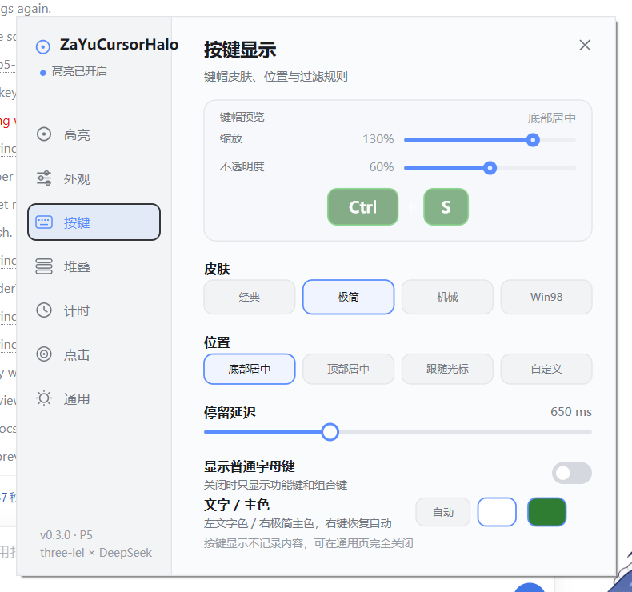
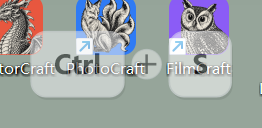
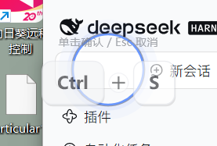
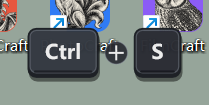
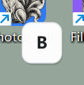

# P3 按键可视化

> 适用版本：ZaYuCursorHalo v0.3.0  
> 当前 exe：842,752 B

## 功能

- 全局低级键盘钩子采集按键，只做屏幕绘制，不记录、不写盘、不发送按键。
- 默认只显示功能键和带修饰键的组合（如 `Ctrl + S`）。
- 修饰键按 `Ctrl → Shift → Alt → Win` 排序，键帽之间显示 `+`。
- 普通字母键默认隐藏；关闭后 Backspace、Enter、Delete、Tab、方向键等功能键仍显示。
- 新的普通键按下时替换旧普通键，快速输入不会累积成 `A + B + C`。
- 被过滤的字母不会延长旧提示的停留；旧提示仍会完成延迟和淡出。
- 连续输入时只保留最新键；要只显示快捷键，关闭“显示普通字母键”。

## 位置

- 底部居中；
- 顶部居中；
- 跟随光标；
- 自定义屏幕位置：设置窗口隐藏，半透明 `Ctrl + S` 残影跟随鼠标，帮助预览最终位置；单击确认，Esc/右键取消。

## 预览框内控制

按键页顶部预览框内直接提供两个滑块：

- **缩放**：70%–150%，默认 100%；
- **不透明度**：20%–100%，默认 100%，调低后可透视下方内容。

两个值都会实时作用于按键层和预览，并持久化到 `[keys]`。







窗口高度随按键行数变化，底部位置保持不变；位置会限制在当前显示器工作区内。

## 皮肤

| 皮肤 | 说明 |
|---|---|
| 经典 | 深色圆角键帽、浅色文字、强调色描边 |
| 极简 | 浅色圆角键帽，填充/边框/文字可由主色与文字色控制 |
| 机械 | 深灰键帽面、白色字符、厚底座和底部阴影 |
| Win98 | 灰色方角按钮、黑白高光/阴影边 |

旧配置里的 `neon` / `paper` / `terminal` 会归一到“极简”。

按键页“文字 / 主色”行：

- 左色块：文字颜色；
- 右色块：极简主色，边框自动取同色系深浅；
- 右键右色块恢复自动；
- 主色只作用于极简皮肤。





## 堆叠显示

侧边栏“堆叠”页：

- 最近最多 5 条快捷键；
- 新记录在底部，旧记录向上堆叠；
- 独立消失延迟 0–3000 ms；
- 进入约 140 ms 淡入/上滑，退出约 160 ms 淡出/下滑；
- 单独按修饰键也会保留一行，使用正常的堆叠延迟和淡出；
- 关闭后立即清空历史，只显示当前组合。


## 连续输入



## 配置

```ini
[keys]
skin=minimal
position=bottom
delay_ms=650
scale_percent=100
opacity_percent=100
show_letter_keys=0
stack=0
stack_delay_ms=650
style_color=auto
text_color=auto
custom_x=0
custom_y=0
custom_set=0
```

## 验证

| 项目 | 结果 |
|---|---|
| 组合键归并 | Ctrl/Shift/Alt/Win + 功能键正确 |
| 过滤字母 | 隐藏字母，但功能键仍显示 |
| 快速输入 | 只替换为最新普通键，不累积 |
| 延迟淡出 | 被过滤按键不跳过延迟/淡出 |
| 缩放 | 70%/100%/150% 窗口与文字同步，不裁剪 |
| 不透明度 | 20%/60%/100% 实际分层窗口 alpha 生效 |
| 定位残影 | 半透明 Ctrl+S 跟随鼠标，提示可见 |
| 跟随鼠标 | 首次显示时记录鼠标位置，固定显示在下方，后续移动鼠标不再追随 |
| 堆叠动画 | 退出行先向下缓出；随后空位收起，下一行完全上移到位后才开始自己的向下缓出 |
| 底部居中 | 显示周期内窗口高度固定，行只做收起，不再与窗口整体位移叠加 |
| 关闭堆叠 | 单行提示恢复向下缓出动画 |
| 输入法 | IME 按键结束提示，但保留原延迟/淡出；快速输入不会复活旧组合键 |
| 快速打字 | 普通字母不会重建快照，旧快捷键按原延迟淡出，不重置计时 |
| 键状态 | `GetAsyncKeyState` 校正漏掉的 key-up，不会永久悬挂 |
| 4 种皮肤 | 切换即时生效 |
| 堆叠 | 3 条记录逐条淡出，不打断当前组合 |

真实 Win7 上仍需复测键帽字宽、分层窗口和动画流畅度。
