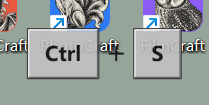
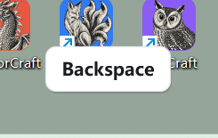
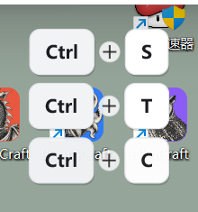
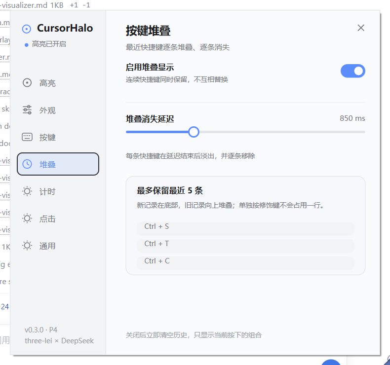

# P3 鎸夐敭鍙鍖?
> 鏃ユ湡锛?026-11-19  
> 浣滆€咃細three-lei 脳 DeepSeek 路 鐗堟湰 0.3.0 路 P4  
> 鑼冨洿锛氬叏灞€閿洏閲囬泦銆侀敭甯藉眰銆佺粍鍚堥敭褰掑苟涓庡仠鐣欍€乣+` 鍒嗛殧銆佺毊鑲ゃ€佷綅缃紙鍚睆骞曡嚜瀹氫箟锛夈€佸仠鐣欏欢杩熴€佸姛鑳介敭杩囨护銆佽缃〉涓庨厤缃寔涔呭寲銆? 
> 澶囨敞锛歅4/P5 娴姩璁℃椂鍣ㄣ€佹墭鐩樺紑鍏炽€侀珮浜?Z 搴忎慨姝ｃ€侀紶鏍囨嫋灏俱€? 濂楀熀纭€閿附鐨偆銆佸灏哄搴旂敤鍥炬爣涓庣偣鍑诲弽棣堝姞鍏ュ悗锛岃缃晶杈规爮涓?7 椤癸紱鑷畾涔夌毊鑲ょ紪杈戝櫒宸茬Щ闄わ紱褰撳墠 exe 涓?809,984 B銆傛湰鏂囨€ц兘鏁版嵁淇濈暀 P3 闃舵鍙ｅ緞銆?
## 浜や粯鐗?
- 閿附灞傦細缁忓吀鐨偆 [`p3-key-overlay.png`](../artifacts/p3-key-overlay.png)銆佹瀬绠€ [`p3-key-overlay-minimal.png`](../artifacts/p3-key-overlay-minimal.png)
- 璁剧疆椤碉細[`p3-keys-page.png`](../artifacts/p3-keys-page.png)
- 鐨偆/鏂囧瓧棰滆壊璁剧疆椤碉細[`p5-keys-skins.png`](../artifacts/p5-keys-skins.png)
- 鏂囧瓧涓庢瀬绠€涓昏壊锛歔`p5-keys-style-color.png`](../artifacts/p5-keys-style-color.png)
- 杩炵画杈撳叆涓嶇疮绉細[`p5-typing-latch.png`](../artifacts/p5-typing-latch.png)
- 鏈烘閿洏鐨偆锛歔`p5-skin-mechanical.png`](../artifacts/p5-skin-mechanical.png)
- Win98 鐨偆锛歔`p5-skin-win98.png`](../artifacts/p5-skin-win98.png)
- 鑷畾涔夌矇鑹叉枃瀛楋細[`p3-key-text-custom.png`](../artifacts/p3-key-text-custom.png)
- 鎸夐敭鏂囧瓧棰滆壊閫夋嫨鍣細[`p3-key-color-picker.png`](../artifacts/p3-key-color-picker.png)
- 鑷畾涔変綅缃ず渚嬶細[`p3-placement-sample.png`](../artifacts/p3-placement-sample.png)
- 鑷畾涔変綅缃缃〉锛歔`p3-keys-page-custom.png`](../artifacts/p3-keys-page-custom.png)
- 鎬ц兘鍥炲綊锛歔`p3-bench-dwm.txt`](../artifacts/p3-bench-dwm.txt)
- 鍐掔儫娴嬭瘯锛歔`p3-smoke.log`](../artifacts/p3-smoke.log)




![鑷畾涔夋枃瀛楅鑹瞉(../artifacts/p3-key-text-custom.png)

![鎸夐敭鏂囧瓧棰滆壊閫夋嫨鍣╙(../artifacts/p3-key-color-picker.png)

## Backspace / Enter 鍒嗙被

鍏抽棴鈥滄樉绀烘櫘閫氬瓧姣嶉敭鈥濆悗锛?
- 瀛楁瘝銆佹暟瀛椼€佺鍙峰拰绌烘牸浣滀负鏅€氬瓧绗﹂敭闅愯棌锛?- **Backspace銆丒nter銆丏elete銆乀ab銆佹柟鍚戦敭绛夊姛鑳?缂栬緫閿粛鐒舵樉绀?*锛?- Backspace 涓嶆槸瀛楁瘝閿紝宸蹭粠瀛楃閿繃婊や腑绉婚櫎锛?- 鍗曠嫭鎸?Enter 涔熶細鏄剧ず銆?


## 浜や簰

- 榛樿鍙湪灞忓箷搴曢儴鏄剧ず鍔熻兘閿拰甯︿慨楗伴敭鐨勭粍鍚堬紝渚嬪 `Ctrl + S`锛?- 鏅€氬瓧姣嶉敭榛樿涓嶆樉绀猴紝鍙湪璁剧疆椤垫墦寮€锛?- 淇グ閿浐瀹氶『搴忥細`Ctrl` 鈫?`Shift` 鈫?`Alt` 鈫?`Win`锛?- 宸﹀彸 Ctrl/Shift/Alt/Win 褰掑苟涓轰竴涓敭甯斤紝鎸変綇涓や晶涓嶄細閲嶅锛?- 缁勫悎鍋滅暀锛氭寜涓?`Ctrl+S` 鍚庡嵆浣垮厛鏉惧紑 `S`锛宍Ctrl+S` 浠嶄繚鎸佹樉绀猴紱鎵€鏈夐敭閮芥澗寮€鍚庢墠寮€濮嬭绠楀仠鐣欏欢杩燂紱
- 鏂扮殑鏅€氶敭鎸変笅鏃舵竻绌烘棫鏅€氶敭锛屽彧淇濈暀鎸変綇鐨勪慨楗伴敭锛岄伩鍏嶅揩閫熻緭鍏ユ椂绱Н鎴?`A + B + C`锛?- 琚繃婊ょ殑鏅€氬瓧姣嶄笉浼氬欢闀挎棫蹇嵎閿殑鍋滅暀锛涙棫鎻愮ず浠嶆寜鍘熷畾寤惰繜娣″嚭锛屼笉浼氳鎸佺画鎸夐敭鈥滄拺浣忊€濓紱
- 榛樿鍋滅暀 650 ms 鍚庢贰鍑猴紱璁剧疆鑼冨洿 0鈥?000 ms锛?- 鍙粯鍒讹紝涓嶈褰曘€佷笉鍐欑洏銆佷笉鍙戦€佹寜閿€?
杩炵画杈撳叆鏃剁殑琛屼负锛?
- 鍏抽棴鈥滄樉绀烘櫘閫氬瓧姣嶉敭鈥濇椂锛屾墦瀛椾腑鐨勫瓧姣嶄笉浼氬欢闀挎棫蹇嵎閿殑鍋滅暀锛涙棫鎻愮ず浠嶄細瀹屾垚寤惰繜鍜屾贰鍑哄姩鐢伙紱
- 鎵撳紑鈥滄樉绀烘櫘閫氬瓧姣嶉敭鈥濇椂锛屽彧鏄剧ず鏈€鏂扮殑鏅€氶敭锛屼笉浼氭妸鍓嶄竴涓瓧姣嶇疮绉繘鍘伙紱
- 濡傛灉涓€鐩磋緭鍏ユ柊鐨勫瓧姣嶏紝鐢婚潰浼氭寔缁樉绀烘渶鏂板瓧姣嶏紝杩欐槸鈥滃綋鍓嶆寜閿€濊涔夛紱瑕佽瀹冨彧鏄剧ず蹇嵎閿紝鍏抽棴鏅€氬瓧姣嶉敭鍗冲彲銆?
## 浣嶇疆

1. **搴曢儴灞呬腑**锛氬綋鍓嶅墠鍙扮獥鍙ｆ墍鍦ㄦ樉绀哄櫒锛屽伐浣滃尯搴曢儴灞呬腑锛岄伩寮€浠诲姟鏍忋€?2. **椤堕儴灞呬腑**锛氬伐浣滃尯椤堕儴灞呬腑銆?3. **璺熼殢鍏夋爣**锛氱粍鍚堝嚭鐜版椂鏀惧埌鍏夋爣闄勮繎锛屽簳閮ㄧ┖闂翠笉瓒虫椂鑷姩缈诲埌鍏夋爣涓婃柟銆?4. **鑷畾涔?*锛氳缃獥鍙ｉ殣钘忥紝绀轰緥閿附璺熼殢榧犳爣锛屽崟鍑荤‘璁わ紝Esc/鍙抽敭鍙栨秷銆?
鑷畾涔変綅缃ā寮忎娇鐢ㄤ竴涓叏灞忛€忔槑鐐瑰嚮灞傛帴鏀剁‘璁?鍙栨秷锛屼笉鎶婄偣鍑婚€忎紶缁欐闈㈠簲鐢ㄣ€傜‘璁や綅缃繚瀛樹负鐗╃悊灞忓箷鍧愭爣锛涙樉绀哄櫒甯冨眬鍙樺寲鏃跺す鍙栧洖宸ヤ綔鍖恒€?
## 鐨偆

鎻愪緵 4 绉嶅熀纭€鐨偆锛?
- **缁忓吀**锛氭繁鑹插渾瑙掗敭甯姐€佹祬鑹叉枃瀛椼€佸己璋冭壊鎻忚竟锛?- **鏋佺畝**锛氭祬鑹插渾瑙掑皬閿附锛涘彲鍦ㄢ€滄枃瀛?/ 涓昏壊鈥濊鍙充晶璁剧疆涓€涓富鑹诧紝杈规鑷姩鍙栧悓鑹茬郴娣辨祬锛?- **鏈烘**锛氭繁鐏伴敭甯介潰銆佺櫧鑹插瓧绗︺€佸帤搴曞骇鍜屽簳閮ㄩ槾褰憋紝妯′豢娣辫壊鏈烘閿附锛?- **Win98**锛氱伆鑹叉柟瑙掓寜閽€侀粦鐧介珮鍏?闃村奖杈癸紝妯′豢 Win98 鎺т欢銆?
鏃ч厤缃噷鐨?`neon` / `paper` / `terminal` 浼氳嚜鍔ㄥ綊涓€鍒扳€滄瀬绠€鈥濓紝閬垮厤鍘嗗彶閰嶇疆澶辨晥銆?
閿附浣跨敤 Direct2D/DirectWrite 缁樺埗鍒?WIC 琛ㄩ潰锛屽啀閫氳繃鍒嗗眰绐楀彛閫愬儚绱?alpha 鎻愪氦锛涘彧瀵圭粍鍚堝彉鍖栭噸缁橈紝涓嶅湪姣忓抚鍒烽敭鐩樺眰銆?
## 鐨偆杈圭晫

鑷畾涔夎儗鏅浘鐗囧拰鐨偆缂栬緫鍣ㄥ凡绉婚櫎锛屽師鍥犳槸涓嶅悓闀垮害閿附鎷変几鏁堟灉涓嶅彲鎺э紝涓旈瑙堟棤娉曞噯纭弽鏄犲疄闄呭搴︺€?
褰撳墠鍙繚鐣?4 涓熀纭€鐨偆锛屼笉鍐嶆墿灞曠毊鑲ょ郴缁燂紱鎸夐敭鏂囧瓧棰滆壊鍜屾瀬绠€涓昏壊浠嶅彲鍗曠嫭鑷畾涔夈€?
鏋佺畝涓昏壊鍏ュ彛鍦ㄢ€滄枃瀛?/ 涓昏壊鈥濊鍙充晶鑹插潡锛屼笉鍐嶅崟鐙崰涓€椤碉細

- 宸﹁壊鍧楁敼鏂囧瓧棰滆壊锛?- 鍙宠壊鍧楁敼鏋佺畝濉厖涓昏壊锛?- 杈规鐢变富鑹茶嚜鍔ㄦ帹瀵兼繁娴咃紱
- 鍙抽敭鍙充晶鑹插潡鎭㈠鑷姩銆?


## 鍫嗗彔鏄剧ず

渚ц竟鏍忔柊澧?**鍫嗗彔** 椤碉細

- 榛樿鍏抽棴锛?- 寮€鍚悗淇濈暀鏈€杩戞渶澶?5 鏉″揩鎹烽敭璁板綍锛?- 鏂拌褰曞湪搴曢儴锛屾棫璁板綍渚濇鍚戜笂鍫嗗彔锛?- **鍫嗗彔娑堝け寤惰繜**鐙珛鍙皟锛?鈥?000 ms锛夛紝涓嶄緷璧栨寜閿仠鐣欏欢杩燂紱
- 姣忔潯璁板綍绾?160 ms 娣″嚭骞跺悜涓嬫粦鍔ㄥ悗绉婚櫎锛屼笉鎵撴柇褰撳墠鎸夐敭锛?- 鏂拌褰曠害 140 ms 娣″叆骞跺悜涓婃粦鍔ㄨ繘鍏ワ紱
- 鍗曠嫭鎸変慨楗伴敭锛圕trl/Shift/Alt/Win锛変笉浼氬崰鐢ㄥ巻鍙茶锛?- 绐楀彛楂樺害闅忚鏁板鍔狅紝搴曢儴浣嶇疆淇濇寔涓嶅彉锛?- 鍏抽棴鍚庣珛鍗虫竻绌哄巻鍙诧紝鍙樉绀哄綋鍓嶇粍鍚堛€?




閰嶇疆锛?
```ini
[keys]
stack=0
stack_delay_ms=650
```

## 鏂囧瓧棰滆壊

鈥滄寜閿€濋〉搴曢儴鏂板 **鏂囧瓧棰滆壊**锛?
- 榛樿鈥滆嚜鍔ㄢ€濓紝姣忕鐨偆浣跨敤鑷繁鐨勯粯璁ゆ枃瀛楄壊锛?- 鐐瑰嚮鍙充晶鑹插潡鎵撳紑 HSV/HEX 棰滆壊閫夋嫨鍣紱
- 閫夋嫨鍚庣珛鍗冲簲鐢ㄥ埌閿附灞傚拰璁剧疆椤甸瑙堬紱
- 鐐瑰嚮鈥滆嚜鍔ㄢ€濇仮澶嶈鐨偆榛樿鑹诧紱
- 閫夋嫨鍣ㄦ敮鎸佹嫋鍔ㄨ壊鐩?楗卞拰搴︺€佹柟鍚戦敭鍜?6 浣?HEX 杈撳叆锛?- 棰滆壊鍙簲鐢ㄦ枃瀛楀拰 `+` 鍒嗛殧绗︼紝涓嶆敼鍙樼毊鑲よ儗鏅?杈规銆?
閰嶇疆锛?
```ini
[keys]
text_color=auto
; 鎴?text_color=FF4D88
```

## 閿洏鎿嶄綔

- 璁剧疆绐楀彛锛歚Tab` / `Shift+Tab` 绉诲姩鐒︾偣锛涘鑸」鐢ㄦ柟鍚戦敭 + `Enter`/`Space` 鍒囬〉锛涙粦鍧楃敤鏂瑰悜閿€乣Home`/`End`銆乣PgUp`/`PgDn`锛涘紑鍏炽€佷富棰樸€佽壊鍧椼€佸揩鎹烽敭鑳跺泭銆佸叧闂寜閽敤 `Enter`/`Space`銆?- 璁剧疆绐楀彛鏄换鍔℃爮绐楀彛锛屽彲浠庝换鍔℃爮鎴?`Alt+Tab` 鍒囧洖锛涘叧闂悗浠诲姟鏍忔寜閽秷澶便€?- 璋冭壊鐩橈細`Tab` 鍦?SV銆佽壊鐩搞€丠EX銆佸彇娑堛€佸畬鎴愰棿寰幆锛汼V/鑹茬浉鏀寔鏂瑰悜閿紱`Enter` 瀹屾垚锛宍Esc` 鍙栨秷銆?- 鎵樼洏闈㈡澘锛氭柟鍚戦敭 / `Tab` 绉诲姩鐒︾偣锛宍Enter`/`Space` 鎵ц锛宍Esc` 鍏抽棴銆?- `Esc` 鍏堝叧闂皟鑹茬洏/闈㈡澘绛夊脊灞傦紝鍐嶅叧闂缃€?- 鎸夐敭鏄剧ず鐢辩嫭绔嬬殑浣庣骇閿洏閽╁瓙閲囬泦锛涜缃墦寮€鏃惰嚜鍔ㄦ殏鍋滐紝鍏抽棴鍚庢仮澶嶃€?
## 璁剧疆椤?
宸︿晶鈥滄寜閿€濋〉鎻愪緵锛?
- 鍚敤/鍏抽棴閿附灞傦紱
- 鐨偆锛氱粡鍏?/ 鏋佺畝 / 鏈烘 / Win98锛?- 浣嶇疆锛氬簳閮ㄥ眳涓?/ 椤堕儴灞呬腑 / 璺熼殢鍏夋爣 / 鑷畾涔夛紱
- 鍋滅暀寤惰繜婊戝潡锛?鈥?000 ms锛?- 鏅€氬瓧姣嶉敭鏄剧ず寮€鍏筹紱
- 鑷畾涔変綅缃寜閽€?
閰嶇疆淇濆瓨鍦細

```ini
[keys]
skin=classic
position=bottom
delay_ms=650
show_letter_keys=0
stack=0
stack_delay_ms=650
style_color=auto
text_color=auto
custom_x=0
custom_y=0
custom_set=0
```

鏃ч厤缃己瀛楁鏃朵娇鐢ㄩ粯璁ゅ€硷細缁忓吀銆佸簳閮ㄥ眳涓€?50 ms銆佸彧鏄剧ず鍔熻兘閿€?
## 瀹炵幇

- `WH_KEYBOARD_LL` 鐙珛绾跨▼锛屽彧璐熻矗閲囬泦涓?`SetEvent`锛屼笉闃诲杈撳叆锛?- 鎸夐敭鐘舵€侀€氳繃 `WM_APP + 51` 鎶曢€掑埌涓荤嚎绋嬶紱
- 閿附灞備娇鐢?`WS_EX_LAYERED | WS_EX_TRANSPARENT | WS_EX_TOOLWINDOW | WS_EX_TOPMOST | WS_EX_NOACTIVATE`锛?- Direct2D 1.0 + DirectWrite 1.0 + WIC 缂撳瓨琛ㄩ潰锛?- 鍙娇鐢?Win7 鑷甫 D2D1/DWrite/WindowsCodecs锛?- 璁剧疆鎵撳紑鏈熼棿閿洏閽╁瓙鏆傚仠锛屽叧闂悗鎭㈠銆?
## 楠岃瘉

| 娴嬭瘯 | 缁撴灉 |
|---|---|
| 榛樿 `Ctrl+S` | 鏄剧ず `Ctrl + S`锛屽甫 `+` 鍒嗛殧 |
| 鏉惧紑 S銆佹寜浣?Ctrl | `Ctrl + S` 淇濇寔鏄剧ず锛屼笉鎻愬墠娑堝け |
| 鍐嶆澗寮€ Ctrl | 650 ms 鍚庡紑濮嬫贰鍑猴紱1000 ms 鏃堕殣钘?|
| `Ctrl+S` 鍚庢寜 `T` | 鍒囨崲涓?`Ctrl + T`锛屼笉甯︽棫 S |
| 宸﹀彸 Ctrl / Shift | 鍚堝苟涓轰竴涓敭甯?|
| 鏅€氬瓧姣嶉敭 | 榛樿涓嶆樉绀猴紱寮€鍏虫墦寮€鍚庢樉绀?|
| Backspace / Enter | 鍏抽棴瀛楁瘝閿悗浠嶆樉绀?|
| 4 绉嶇毊鑲?| 缁忓吀/鏋佺畝/鏈烘/Win98 鍒囨崲鍗虫椂鐢熸晥 |
| 鏋佺畝涓昏壊 | 鏂囧瓧鑹插彸渚ц壊鍧楁敼濉厖锛岃竟妗嗚嚜鍔ㄥ彇鍚岃壊娣辨祬锛涘彸閿仮澶嶈嚜鍔?|
| 杩炵画杈撳叆 | 杩囨护瀛楁瘝涓嶅欢闀挎棫鎻愮ず锛屽欢杩熷拰娣″嚭瀹屾暣鎾斁锛涙樉绀哄瓧姣嶆椂鍙繚鐣欐渶鏂伴敭锛屼笉绱Н |

| 鏂囧瓧棰滆壊鑷姩 | 鍚勭毊鑲や娇鐢ㄩ粯璁よ壊 |
| 鏂囧瓧棰滆壊鑷畾涔?| HSV/HEX 閫夋嫨鍚庨敭甯藉眰鍜岄瑙堝悓姝ュ彉鑹?|
| 鏂囧瓧棰滆壊鎭㈠鑷姩 | 鐐瑰嚮鈥滆嚜鍔ㄢ€濇仮澶嶇毊鑲ら粯璁よ壊 |
| 鑷畾涔変綅缃?| 绀轰緥璺熼殢榧犳爣锛屽崟鍑荤‘璁わ紝Esc 鍙栨秷 |
| 搴曢儴灞呬腑 / 椤堕儴灞呬腑 | 浣嶇疆鍜屽搴︽纭紝閬垮紑浠诲姟鏍?|
| 璺熼殢鍏夋爣 | 鍑虹幇鍦ㄥ厜鏍囬檮杩戯紱搴曢儴涓嶈冻鏃剁炕鍒颁笂鏂?|
| 蹇嵎閿綍鍒?| 璁剧疆鏆傚仠閽╁瓙鍚庯紝`Ctrl+Shift+F8` 褰曞埗/鍐茬獊/鎭㈠浠嶆甯?|

## 鎬ц兘

P3 闃舵锛?
- 164.6 FPS锛宲99 6.528 ms锛屾櫄甯?2/1399锛?- 绉诲姩 CPU 5.30%锛?- 绌洪棽 CPU 0.00%锛?- 宸ヤ綔闆嗙害 23 MB锛?- exe 477,696 B锛圥3 闃舵锛夛紝褰撳墠 P5 涓?809,984 B銆?
閿附鍙湪缁勫悎鍙樺寲鏃剁粯鍒讹紝绌洪棽鏃朵粛涓洪浂 CPU銆侭enchmark 妯″紡涓嶅惎鐢ㄩ敭甯介挬瀛愩€?
## 宸茬煡闄愬埗

- 鎻愭潈绐楀彛锛堝浠ョ鐞嗗憳韬唤杩愯鐨勪换鍔＄鐞嗗櫒锛夊彲鑳界粫杩囦腑瀹屾暣鎬ц繘绋嬬殑浣庣骇閿洏閽╁瓙锛汼ecure Desktop锛圕trl+Alt+Del锛夋棤娉曟崟鑾枫€?- 閿洏閽╁瓙鍙鐘舵€侊紝涓嶆嫤鎴€佷笉娉ㄥ叆銆佷笉璁板綍銆?- 鍏ㄥ睆鐙崰娓告垙鍙兘瑕嗙洊閿附灞傘€?- 鐪熷疄 Win7 涓婄殑 D2D/DWrite 瀛椾綋娓叉煋浠嶉渶鐪熸満澶嶆祴銆?- 鑷畾涔変綅缃娇鐢ㄥ叏灞忛€忔槑鐐瑰嚮灞傦紝纭鏈熼棿浼氭殏鏃舵嫤鎴闈㈢偣鍑汇€?
## 涓嬩竴鐗?
- 缁勫悎閿揩鎹烽敭鎻愮ず/鏁欏妯″紡锛?- 鎸夐敭鍘嗗彶浠呭唴瀛樺睍绀猴紙涓嶈惤鐩橈級锛?- 澶氭樉绀哄櫒娣峰悎 DPI 浣嶇疆淇锛?- 鏇寸粏鐨勯敭甯藉姩鐢诲拰鐨偆銆?
