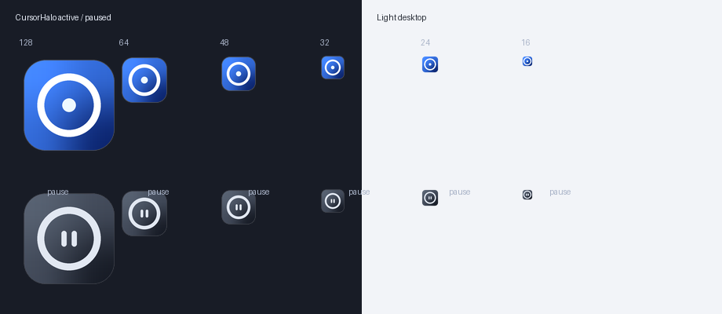

# P4 应用图标

> 适用版本：ZaYuCursorHalo v0.3.0

## 组成

- `res/tray_active.ico`：启用状态，多尺寸 16/20/24/32/48/64/128/256；
- `res/tray_paused.ico`：暂停状态，同一套尺寸；
- 托盘、任务栏、Alt+Tab 和设置窗口共享应用图标；
- 资源以 `IDI_TRAY_ACTIVE` / `IDI_TRAY_PAUSED` 打包进 exe。

## 行为

- 启用/暂停时切换托盘图标；
- 设置窗口使用 `WS_EX_APPWINDOW`，显示任务栏按钮和 Alt+Tab；
- Windows 缓存 exe 图标；替换 exe 后如果仍显示旧图标，重启 Explorer 或清理图标缓存。

## 验证

- 16×16 托盘可辨识；
- 32×32 任务栏/Alt+Tab 可辨识；
- 高 DPI 下不模糊；
- 启用/暂停切换即时生效。
