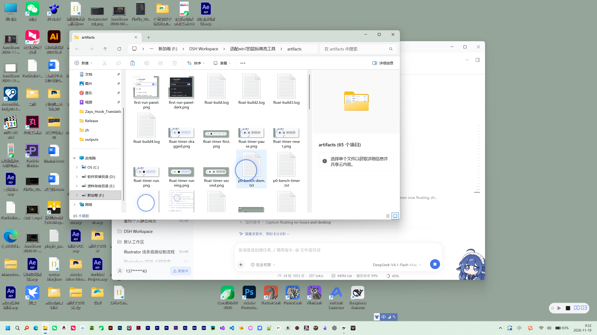

# P4 娴姩璁℃椂鍣?
> 鏃ユ湡锛?026-11-19  
> 浣滆€咃細three-lei 脳 DeepSeek 路 鐗堟湰 0.3.0 路 P4  
> 鑼冨洿锛氭闈㈡诞鍔ㄧ疆椤惰鏃跺櫒銆佹嫋鍔ㄦ彙鎶娿€佸伐浣滃尯闄愬埗銆佷綅缃寔涔呭寲銆侀€愬儚绱?alpha 鍦嗚銆丏SEG7 Modern 瀛椾綋銆佽缃〉銆佹墭鐩橀潰鏉垮揩鎹峰紑鍏充笌閰嶇疆銆? 
> 缁撹锛歐in11 125% 缂╂斁涓嬫诞鍔ㄤ綅缃€佹嫋鍔ㄣ€侀噸鍚仮澶嶃€佸伐浣滃尯闄愬埗銆佸紑濮?鏆傚仠/閲嶇疆銆佽缃〉鍜屾墭鐩橀潰鏉垮紑鍏抽€氳繃锛沇in7 鐨勯€愬儚绱?alpha 鍦嗚浠嶉渶鐪熸満瑙嗚澶嶆祴銆?
## 浜や粯鐗?
- 鍙墽琛屾枃浠讹細[`dist/CursorHalo.exe`](../dist/CursorHalo.exe)锛?.3.0.0锛孭4 澧為噺銆?- 娴姩璁℃椂鍣細[`p4-timer-floating.png`](../artifacts/p4-timer-floating.png)
- 妗岄潰鍏ㄥ浘锛歔`p4-timer-desktop.png`](../artifacts/p4-timer-desktop.png)
- 鏆傚仠鐘舵€侊細[`p4-timer-paused.png`](../artifacts/p4-timer-paused.png)
- 鎷栧姩鍚庯細[`p4-timer-dragged.png`](../artifacts/p4-timer-dragged.png)
- 璁剧疆椤碉細[`p4-timer-settings.png`](../artifacts/p4-timer-settings.png)
- 鎵樼洏闈㈡澘蹇嵎寮€鍏筹細[`p4-tray-panel.png`](../artifacts/p4-tray-panel.png)
- 鍏抽棴鐘舵€侊細[`p4-tray-panel-off.png`](../artifacts/p4-tray-panel-off.png)
- 涓嶆樉绀哄皬鏃讹細[`p4-timer-nohours.png`](../artifacts/p4-timer-nohours.png)
- 閲嶇疆缁撴灉锛歔`p4-timer-reset.png`](../artifacts/p4-timer-reset.png)
- Explorer 閲嶅惎鎭㈠锛歔`p4-timer-after-explorer-restart.png`](../artifacts/p4-timer-after-explorer-restart.png)
- 鎬ц兘鍥炲綊锛歔`p4-bench-dwm.txt`](../artifacts/p4-bench-dwm.txt)
- 鍐掔儫娴嬭瘯锛歔`p4-smoke.log`](../artifacts/p4-smoke.log)

![娴姩璁℃椂鍣╙(../artifacts/p4-timer-floating.png)



![鏆傚仠鐘舵€乚(../artifacts/p4-timer-paused.png)

![鎷栧姩鍚嶿(../artifacts/p4-timer-dragged.png)

![璁℃椂鍣ㄨ缃甝(../artifacts/p4-timer-settings.png)

![鎵樼洏闈㈡澘蹇嵎寮€鍏砞(../artifacts/p4-tray-panel.png)

## 浣嶇疆涓庢嫋鍔?
- 榛樿鏀惧湪涓绘樉绀哄櫒宸ヤ綔鍖哄彸涓嬭锛屼綅浜庝换鍔℃爮涓婃柟 24 DIP锛屼笉瑕嗙洊浠诲姟鏍忓拰鎵樼洏鍥炬爣銆?- 璁℃椂鍣ㄥ乏渚ф湁鍏偣鎻℃妸锛涙寜浣忔彙鎶婂彲鎷栧埌浠绘剰宸ヤ綔鍖轰綅缃€?- 鎷栧姩鏃舵寜鍏夋爣鎵€鍦ㄦ樉绀哄櫒鐨勫伐浣滃尯瀹炴椂闄愬埗锛?  - 涓嶈繘鍏ヤ换鍔℃爮锛?  - 涓嶈秴鍑哄睆骞曡竟缂橈紱
  - 鏀寔澶氭樉绀哄櫒銆?- 鏉惧紑鎻℃妸鍚庝繚瀛樹綅缃紱涓嬫鍚姩鎭㈠鍒板悓涓€浣嶇疆銆?- 浣嶇疆淇濆瓨涓哄睆骞曠墿鐞嗗潗鏍囷細

```ini
[timer]
x=480
y=475
has_position=1
```

- 鏄剧ず鍣ㄥ垎杈ㄧ巼/浠诲姟鏍忎綅缃敼鍙樻椂锛屼笅娆″埛鏂颁細鎶婄獥鍙ｉ噸鏂伴檺鍒跺埌宸ヤ綔鍖猴紱淇濆瓨鐐逛笉鍦ㄤ换浣曞睆骞曞唴鏃惰惤鍒版渶杩戞樉绀哄櫒宸ヤ綔鍖恒€?- 璁℃椂鍣ㄦ槸鐙珛缃《娴姩绐楀彛锛屼笉浣跨敤 DeskBand銆佷换鍔℃爮瀛愮獥鍙ｆ垨 `Shell_TrayWnd` owner锛涗换鍔℃爮鍥炬爣涓嶄細琚鐩栥€?
## 澶栬涓庡渾瑙?
Win7 鐨勬棫瀹炵幇鐢?`SetWindowRgn(CreateRoundRectRgn)` 瑁佸壀鍦嗚锛屽尯鍩熻鍓病鏈夋姉閿娇锛屽渾瑙掍細鍛堥樁姊姸銆?
鐜板湪鏀逛负锛?
- `WS_EX_LAYERED` 鍒嗗眰绐楀彛锛?- 32bpp 棰勪箻 alpha DIB + `UpdateLayeredWindow`锛?- 鍦嗚鑳跺泭銆佹挱鏀?鍋滄鍥炬爣銆佹彙鎶婂拰鏂囧瓧鍏ㄩ儴鐢?GDI+ 鎶楅敮榻跨粯鍒讹紱
- 涓嶅啀浣跨敤绐楀彛鍖哄煙瑁佸壀銆?
鍥犳鍦嗚杈圭紭鏄€愬儚绱犲崐閫忔槑鐨勶紝Win7 Aero/鍩烘湰涓婚涓嬩笉搴斿啀鍑虹幇纭敮榻裤€?
- 鑳屾櫙銆佽竟妗嗐€佹挱鏀?鍋滄鍥炬爣鍜屾彙鎶婂潎浣跨敤 GDI+ 骞虫粦缁樺埗銆?- 鏃堕棿鐮佷娇鐢?DSEG7 Modern 绉佹湁瀛椾綋锛涙暟瀛楀浐瀹氬崟鍏冩牸锛屽啋鍙风嫭绔嬬獎鍗曞厓鏍硷紝绉掓暟鍙樺寲涓嶄細宸﹀彸鎶栧姩銆?- 杩愯涓椂闂寸爜浣跨敤褰撳墠寮鸿皟鑹诧紱瀵规瘮搴︿笉瓒虫椂鍥為€€楂樺姣旀枃瀛楄壊銆?- 棰滆壊璺熼殢搴旂敤鍐呮祬鑹?娣辫壊涓婚銆?
## 鎸夐挳涓庤鏃?
甯冨眬锛歚[鎻℃妸] [鈻禲 [鈻燷 [鍒嗘] HH:MM:SS`

| 鎿嶄綔 | 鏁堟灉 |
|---|---|
| `鈻禶 | 寮€濮?缁х画 |
| `鈻燻 杩愯涓?| 鏆傚仠骞朵繚鐣欐椂闂?|
| `鈻燻 鏆傚仠涓啀娆＄偣鍑?| 褰掗浂 |
| 璁剧疆椤碘€滈噸缃€?| 鍋滄骞跺綊闆?|
| 鈥滃仠姝㈡椂褰掗浂鈥?| 杩愯涓偣鍑诲仠姝㈢洿鎺ュ綊闆?|
| 鈥滃惎鍔ㄦ椂鑷姩寮€濮嬧€?| 涓嬫搴旂敤鍚姩鑷姩寮€濮?|

璁℃椂鍣ㄧ嫭绔嬩簬榧犳爣楂樹寒銆佹寜閿樉绀哄拰璁剧疆绐楀彛锛涙墦寮€璁剧疆鎴栧叧闂珮浜笉浼氬仠姝㈣鏃躲€?
## 璁剧疆椤?
宸︿晶鈥滆鏃垛€濋〉锛?
- 鍚敤璁℃椂鍣?- 鍚姩鏃惰嚜鍔ㄥ紑濮?- 鏄剧ず灏忔椂浣嶏紙`HH:MM:SS` / `MM:SS`锛?- 鍋滄鏃跺綊闆?- 鎵嬪姩閲嶇疆
- 椤佃剼璇存槑鈥滄嫋鍔ㄥ乏渚ф彙鎶婄Щ鍔ㄨ鏃跺櫒锛涗綅缃嚜鍔ㄤ繚瀛橈紝骞堕檺鍒跺湪宸ヤ綔鍖哄唴鈥?
鍏ㄩ儴鎺т欢鏀寔閿洏鐒︾偣銆佹柟鍚戦敭鍜?Enter/Space銆?
## 鎵樼洏鍙抽敭闈㈡澘蹇嵎寮€鍏?
鎵樼洏鍙抽敭闈㈡澘鐩存帴鎻愪緵鍏釜寮€鍏筹細

- 鍚敤楂樹寒
- **鏄剧ず鎸夐敭**锛堥敭鐩橀敭甯藉眰锛?- **娴姩璁℃椂鍣?*
- **榧犳爣鎷栧熬**
- **鐐瑰嚮娉㈢汗**
- **鐐瑰嚮闊虫晥**

鐐瑰嚮鍚庣珛鍗崇敓鏁堬紝骞跺悓姝ュ啓鍏ラ厤缃紱璁剧疆椤靛拰鎵樼洏闈㈡澘鐘舵€佷簰鐩稿悓姝ャ€傚叧闂€滄樉绀烘寜閿€濅細鍗歌浇閿洏閽╁瓙锛屽叧闂€滄诞鍔ㄨ鏃跺櫒鈥濅細绔嬪嵆闅愯棌娴姩鑳跺泭骞舵殏鍋滆鏃躲€傞潰鏉夸繚鐣欌€滆缃€︹€濆拰鈥滈€€鍑?CursorHalo鈥濓紝鐗堟湰涓庣讲鍚嶆樉绀哄湪鏍囬鍖恒€?
![鎵樼洏闈㈡澘鍏抽棴鐘舵€乚(../artifacts/p4-tray-panel-off.png)

## 瀛椾綋涓庡疄鐜?
### 瀛椾綋

- `dseg7-modern.ttf`锛圖SEG7 Modern锛変互 `RCDATA`锛坄IDR_TIMER_FONT`锛夋墦鍖呰繘 exe锛涘瓧浣撲负 SIL OFL 1.1銆?- 閫氳繃 GDI+ `PrivateFontCollection::AddMemoryFont` 鍔犺浇缁欑粯鍒朵娇鐢ㄣ€?- 鍚屾椂閫氳繃 GDI `AddFontMemResourceEx` + `CreateFontW` 鑾峰彇绮剧‘瀛楃瀹藉害锛岄伩鍏?GDI+ `MeasureString` 鐨勯澶栫暀鐧藉鑷存暟瀛楅棿璺濊繃澶с€?- 涓嶅畨瑁呫€佷笉钀界洏銆佷笉鍐欐敞鍐岃〃锛涘瓧浣撳姞杞藉け璐ユ椂鍥為€€ Consolas銆?
### 娓叉煋

- 鍒嗗眰绐楀彛锛歚WS_EX_LAYERED | WS_EX_TOOLWINDOW | WS_EX_TOPMOST | WS_EX_NOACTIVATE`
- 32bpp `PixelFormat32bppPARGB` DIB锛孏DI+ 鐩存帴缁樺埗 DIB 鍍忕礌
- `UpdateLayeredWindow` 鎻愪氦棰勪箻 alpha
- 鍙娇鐢?Win7 鑷甫 GDI/GDI+/USER32/ADVAPI32 API

### 璁℃椂

- `GetTickCount64` 绱姣
- 杩愯鏃?100 ms 绉掕〃瀹氭椂鍣紱绉掓暟鍙樺寲鎵嶉噸鏂扮粯鍒?- 鏆傚仠鏃舵病鏈夊畾鏃跺櫒锛岄潤姝?CPU 涓?0

## 楠岃瘉

| 娴嬭瘯 | 缁撴灉 |
|---|---|
| 榛樿浣嶇疆 | 涓诲睆鍙充笅銆佷换鍔℃爮涓婃柟 24 DIP锛屼笉瑕嗙洊鎵樼洏 |
| 鎷栧姩鎻℃妸 | 浠庡彸涓嬫嫋鍒?`(384, 380)`锛岀獥鍙ｈ窡闅忥紝鍏夋爣鍙樹负绉诲姩鏍峰紡 |
| 浣嶇疆鎸佷箙鍖?| 閰嶇疆淇濆瓨 `x=480, y=475, has_position=1`锛涢噸鍚悗鍥炲埌鍚屼竴浣嶇疆 |
| 鎷栧埌浠诲姟鏍?| 绐楀彛搴曢儴琚檺鍒跺湪宸ヤ綔鍖哄簳閮紝杈圭晫涓庝换鍔℃爮椤堕儴榻愬钩锛屼笉杩涘叆浠诲姟鏍?|
| 鎸夐挳 | 寮€濮?缁х画銆佹殏鍋溿€佹殏鍋滃悗褰掗浂銆佽缃〉閲嶇疆鍧囨甯?|
| 鎵樼洏闈㈡澘鈥滄樉绀烘寜閿€?| 寮€鍏冲嵆鏃跺垏鎹紝`show_keys` 鍚屾锛岄潰鏉夸笌璁剧疆椤电姸鎬佷竴鑷?|
| 鎵樼洏闈㈡澘鈥滄诞鍔ㄨ鏃跺櫒鈥?| 鍏抽棴鍚庤兌鍥婄珛鍗抽殣钘忥紝閲嶆柊寮€鍚悗鎭㈠锛涢厤缃悓姝?|
| 鎵樼洏闈㈡澘閿洏 | 8 涓劍鐐归」锛孴ab 寰幆锛孍nter/Space 鍒囨崲 |
| 鏄剧ず灏忔椂浣?| `HH:MM:SS` 涓?`MM:SS`锛屽搴﹁嚜鍔ㄥ彉鍖?|
| 鏃堕棿鐮佺ǔ瀹?| 鍥哄畾鏁板瓧鍗曞厓鏍硷紝绉掓暟鍙樺寲涓嶆姈鍔?|
| 鍦嗚 | 閫愬儚绱?alpha锛屾棤绐楀彛鍖哄煙瑁佸壀锛沇in11 鎴浘鍦嗚骞虫粦 |
| 鎷栧姩/鎸夐挳鍛戒腑 | 鎻℃妸銆佹挱鏀俱€佸仠姝㈠潎鏀寔榧犳爣 |
| Explorer 閲嶅惎 | 璁℃椂鍣ㄤ笉渚濊禆浠诲姟鏍?owner锛岄噸鍚悗浠嶆樉绀轰笖缁х画璁℃椂 |
| 绌洪棽 CPU | 绋冲畾鍦?0.00%/鍗曟牳 |
| 璁℃椂杩愯 CPU | 8 绉掗噰鏍?0.59%/鍗曟牳 |

## 鎬ц兘

| 鎸囨爣 | P3 | P4 娴姩璁℃椂鍣?|
|---|---:|---:|
| FPS | 164.6 / 165.0 | 164.4 / 165.0 |
| interval p99 | 6.528 ms | 6.657 ms |
| 鏅氬抚 >1.5脳 | 2 / 1399 | 3 / 1398 |
| 绉诲姩 CPU锛堝崟鏍革級 | 5.30% | 5.66% |
| 闈欐 CPU锛堢ǔ瀹氬悗锛?| 0.00% | 0.00% |
| 璁℃椂杩愯 CPU锛堝崟鏍革級 | 鈥?| 0.59%锛? 绉掗噰鏍凤級 |
| 宸ヤ綔闆?| 23.3 MB | 24.3 MB锛堟嫋灏鹃粯璁ゅ叧闂級 |
| exe | 477,696 B | 809,984 B |

exe 澧炲姞绾?224 KB锛屼富瑕佹潵鑷?DSEG7 瀛椾綋璧勬簮銆丟DI+ 娴姩绐楀彛銆佹嫋鍔?浣嶇疆浠ｇ爜銆佹墭鐩橀潰鏉裤€侀紶鏍囨嫋灏俱€侀敭甯界毊鑲ゃ€佸灏哄搴旂敤鍥炬爣銆佺偣鍑诲弽棣堝拰闊虫晥璧勬簮銆傝鏃跺櫒鍙湪绉掑彉鍖栥€佹偓鍋溿€佹嫋鍔ㄦ椂閲嶇粯銆?
## 鍏煎鎬?
- 瀛椾綋锛欸DI+ `PrivateFontCollection`銆丟DI `AddFontMemResourceEx`锛學indows XP+銆?- 鍒嗗眰锛歚UpdateLayeredWindow`锛學indows 2000+銆?- 璁℃椂锛歚GetTickCount64`锛孷ista+銆?- DPI锛歚GetDpiForMonitor` 鍔ㄦ€佸姞杞斤紝Win7 鍥為€€绯荤粺 DPI銆?- 瀵煎叆琛細`KERNEL32`銆乣USER32`銆乣GDI32`銆乣gdiplus`銆乣ole32`銆乣SHELL32`銆乣ADVAPI32`銆乣d2d1`銆乣dwmapi`銆乣DWrite`銆乣IMM32`锛屾棤 VC Runtime/API set 闈欐€佷緷璧栥€?- 鏈湪鐪熷疄 Win7 涓婇獙璇侀€愬儚绱?alpha 鐨勬渶缁堣瑙夋晥鏋滐紱宸茬Щ闄ゆ棫鐨勫尯鍩熻鍓矾寰勩€?
## 宸茬煡闄愬埗

- 璁℃椂鍣ㄥ缁堢疆椤讹紝浼氭诞鍦ㄦ櫘閫氬簲鐢ㄤ笂鏂癸紱杩欐槸褰曞睆鐢ㄩ€旂殑鏈夋剰琛屼负銆?- 鍙兘閫氳繃宸︿晶鎻℃妸鎷栧姩锛屼笉鑳芥嫋鍔ㄦ暣涓兌鍥娿€?- 浣嶇疆淇濆瓨涓虹粷瀵圭墿鐞嗗潗鏍囷紱澶у箙鏀瑰彉鏄剧ず鍣ㄥ竷灞€鍚庡彲鑳借闄愬埗鍒版渶杩戝伐浣滃尯銆?- 浠诲姟鏍忚嚜鍔ㄩ殣钘忔椂浠嶆寜宸ヤ綔鍖洪檺鍒讹紝涓嶄富鍔ㄨ窡闅忎换鍔℃爮闅愯棌銆?- 璁℃椂鐘舵€佷笉鎸佷箙鍖栵紝閫€鍑哄簲鐢ㄥ悗涓㈠け锛涙病鏈夊巻鍙茶褰?瀵煎嚭/澶氭璁℃椂銆?- 鑷姩寮€濮嬪彧鍦ㄥ簲鐢ㄥ惎鍔ㄦ椂鍒ゆ柇涓€娆°€?- 鍏ㄥ睆搴旂敤/娓告垙涓婃柟浠嶅彲鑳芥樉绀恒€?- 娌℃湁閲嶇疆浣嶇疆鎸夐挳锛涘彲鎷栧洖灞忓箷鍐咃紝浣嶇疆浼氳嚜鍔ㄩ檺鍒躲€?- Win7 鍦嗚鏈€缁堟晥鏋滈渶瑕佺湡鏈哄娴嬶紱浠ｇ爜宸蹭笉鍐嶄娇鐢?`SetWindowRgn`銆?
## 涓嬩竴姝?
1. 鐪熷疄 Win7 Aero/Basic 涓嬪娴嬮€愬儚绱?alpha 鍦嗚涓?DSEG7 瀛楀銆?2. 鍙€夛細淇濆瓨/鎭㈠璁℃椂鐘舵€併€佸巻鍙茶褰曘€佸揩鎹烽敭鎺у埗銆?3. 鍙€夛細鏁村潡鑳跺泭鎷栧姩銆侀噸缃綅缃寜閽€佸惛闄勮竟缂樸€?4. 澶氭樉绀哄櫒娣峰悎 DPI銆佽嚜鍔ㄩ殣钘忎换鍔℃爮銆佽繙绋嬫闈㈠洖褰掋€?


