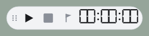
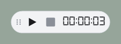
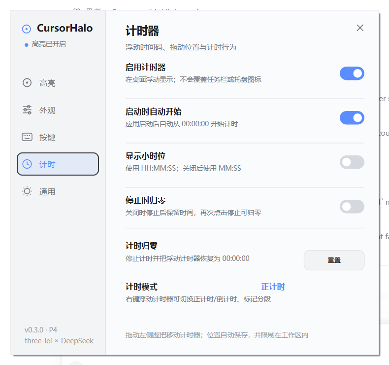

# P4 浮动计时器

> 适用版本：ZaYuCursorHalo v0.3.0  
> exe：825,344 B

## 界面

桌面置顶胶囊：

```text
[握把] [▶] [■] [分段] 00:00:00
```

- 左侧六点握把可拖动，位置自动保存；
- ▶ 开始/继续；
- ■ 暂停，暂停时再点 ■ 归零；
- 分段按钮打点，显示最近一段时长；
- 右键可切换正计时/倒计时；
- 时间码数字固定单元格，秒变化不左右抖动；
- DSEG7 字号按胶囊高度约 46% 计算，并对光学校心做小幅左下修正；
- 胶囊因字体/小时位/分段/DPI 改变尺寸时，保持视觉中心不跳动；
- 位置限制在任务栏上方工作区，不覆盖托盘图标。








## 计时模式

- 正计时：从 00:00:00 开始累计；
- 倒计时：右键选择 5/10/15/25/45/60 分钟，或自定义 1–99 分钟；
- 自定义分钟对话框使用 ASCII 资源文本，运行时设置中文，避免 RC 编码问题；
- 暂停/继续/归零状态同步到托盘面板和设置页。

## 字体

- 时间码使用 `DSEG7 Modern` 私有字体，SIL OFL 1.1；
- 字体以 `RCDATA`（`IDR_TIMER_FONT`）打包进 exe，不安装、不落盘、不写注册表；
- 通过 GDI+ `PrivateFontCollection::AddMemoryFont` 加载绘制；
- 通过 GDI `AddFontMemResourceEx` + `CreateFontW` 获取精确字符宽度；
- 字体加载失败时回退 Consolas。

## 设置

侧边栏“计时”页：

- 启用/隐藏计时器；
- 启动时自动开始；
- 显示小时位；
- 停止时归零；
- 手动重置。

## 配置

```ini
[timer]
enabled=0
auto_start=0
show_hours=1
reset_on_stop=0
mode=up
countdown_minutes=5
x=0
y=0
has_position=0
```

## 验证

| 项目 | 结果 |
|---|---|
| 正计时 | 开始/暂停/继续/归零 |
| 倒计时 | 预设与 1–99 分钟自定义 |
| 拖动 | 位置保存并在重启后恢复 |
| 分段 | 最近一段时长显示 |
| Aero / Basic | DWM 可用时按合成节拍，不可用时计时器回退 |
| 字体 | DSEG7 数字等宽，冒号固定 |

真实 Win7 Aero/Basic 下仍需复测逐像素 alpha 圆角与字宽。
