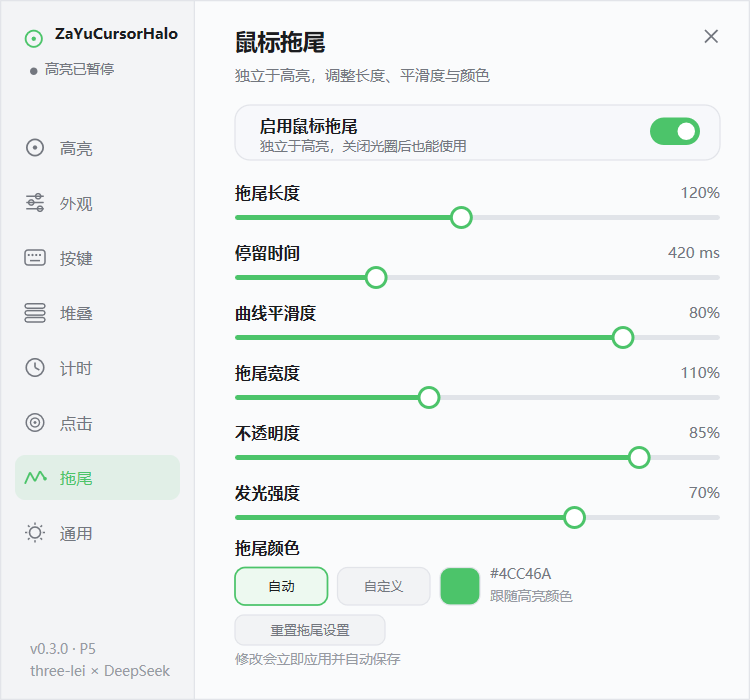
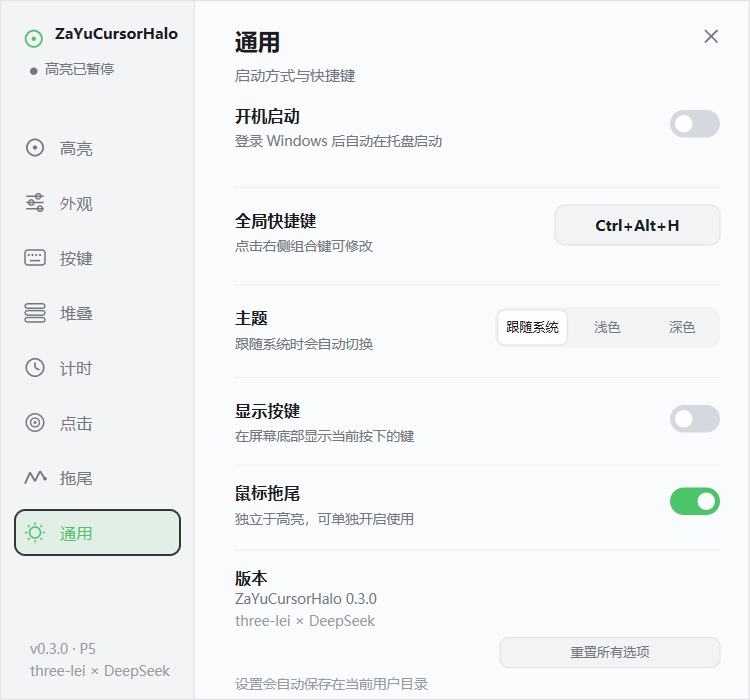

# P4 鼠标拖尾

> 适用版本：ZaYuCursorHalo v0.3.0

## 行为

- 侧边栏“拖尾”页和托盘面板都可独立开关，默认关闭；
- 不依赖“启用高亮”，关闭高亮/暂停光环后仍可单独使用；
- 移动时在指针后方绘制尾部收细、带渐隐和光晕的延迟曲线；
- 停止移动后按配置的停留时间消失；
- 不使用系统指针轨迹，不安装鼠标钩子；
- 分层窗口点击直接穿透。






## 设置项

- 拖尾长度：50%–200%，控制轨迹保留的最大距离；
- 停留时间：100–1200 ms，控制鼠标停下后拖尾保持多久；
- 曲线平滑度：0–100%，越低越接近折线，越高越圆滑；
- 拖尾宽度：50%–200%；
- 不透明度：10%–100%；
- 发光强度：0–100%，0 时关闭外层光晕；
- 颜色：自动跟随高亮颜色，或自定义颜色；
- 重置拖尾设置：恢复本页所有默认值；
- 停止移动后拖尾与末端圆点一起淡出，不再突然消失。

## 配置

```ini
[trail]
enabled=0
length_percent=100
lifetime_ms=320
smoothness=70
width_percent=100
opacity_percent=100
glow_percent=60
color_auto=1
color=5B8DFF
```

## 验证

- 快速移动拖尾连续、无断裂；
- 停止后按停留时间消失；
- 空闲时不刷新、不占 CPU；
- 设置/托盘面板打开时仍可显示；
- 关闭“启用高亮”后移动鼠标，拖尾仍正常绘制。
