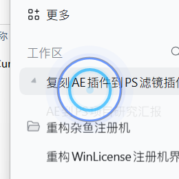
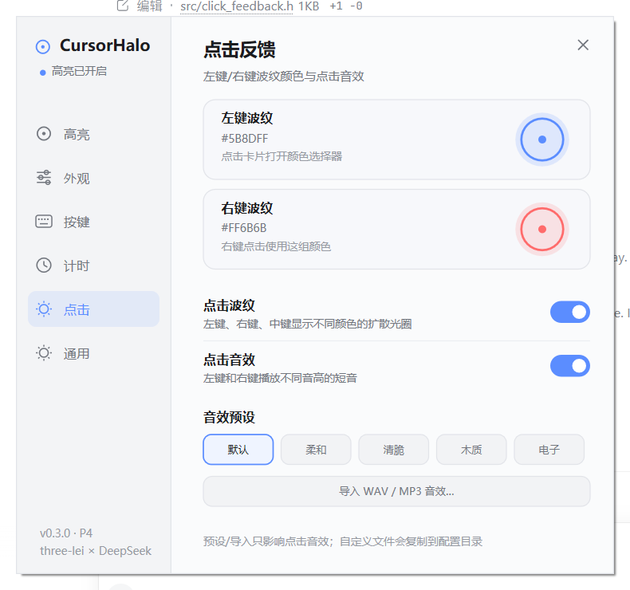
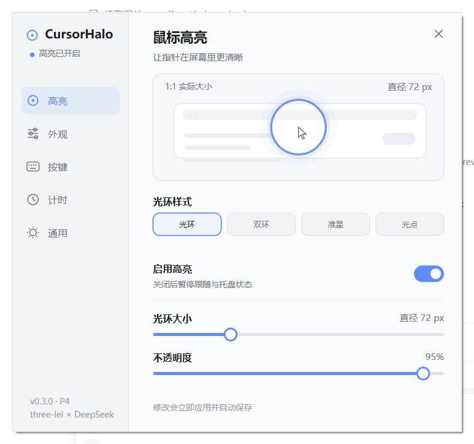

# P5 点击反馈与光环样式

> 适用版本：ZaYuCursorHalo v0.3.0  
> exe：816,640 B

## 点击波纹

- 左键、右键分别设置颜色（HSV/HEX）；
- 波纹在点击位置扩散并淡出；
- 颜色即时生效并持久化。



## 点击音效

侧边栏“点击”页提供 5 组预设：

- 默认；
- 柔和；
- 清脆；
- 木纹；
- 合成。



- 点击预设立即试听；
- 支持导入 WAV/MP3；
- WAV 原样复制到 `%APPDATA%\ZaYuCursorHalo\sounds`；
- MP3 使用内置 minimp3 解码为 16-bit PCM WAV，最长 15 秒；
- 导入后自动切换到“自定义”，左/右键共用；
- 再次导入会替换自定义文件；内置预设仍可随时切回。

```ini
[effects]
click_ripple=0
click_sound=0
left_color=5B8DFF
right_color=FF6B6B
sound_preset=crisp
sound_file=
```

## 光环样式

设置侧边栏“外观”页：

- 光环；
- 双环；
- 准星；
- 光点。



## 音效实现

- 内置 WAV 以 `WAVE` 资源嵌入 exe；
- `PlaySoundW` 播放资源；
- 自定义 WAV 使用 `PlaySound`，失败时回退 MCI；
- MP3 不做运行时解码，导入时转成 WAV；
- 单实例播放限制，快速点击可能合并。

## 验证

| 项目 | 结果 |
|---|---|
| 10 个预设资源 | 全部可加载/播放 |
| 清脆预设 | 55 ms，已提高振幅和时长 |
| WAV 导入 | 复制并可播放 |
| MP3 导入 | minimp3 解码，最长 15 秒 |
| 左右键颜色 | 独立生效并持久化 |
| 4 种光环样式 | 设置页即时切换 |
