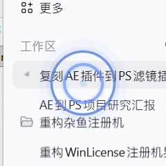
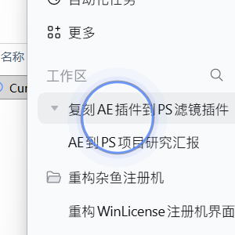
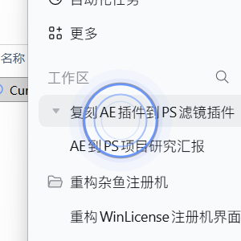
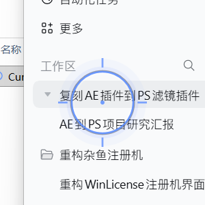
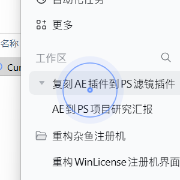
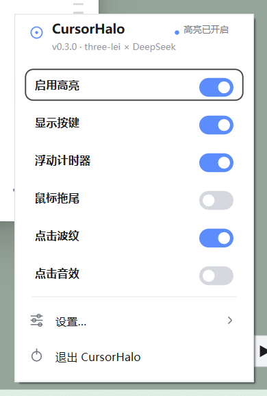

# P5 鐐瑰嚮鍙嶉銆佸€掕鏃?鍒嗘涓庡厜鐜牱寮?
> 鏃ユ湡锛?026-11-20  
> 浣滆€咃細three-lei 脳 DeepSeek 路 鐗堟湰 0.3.0 路 P5  
> 鑼冨洿锛氱偣鍑绘尝绾广€佸乏鍙抽敭鐐瑰嚮闊虫晥銆佽鏃跺櫒鍊掕鏃躲€佸垎娈垫墦鐐广€? 绉嶅厜鐜牱寮忋€? 
> Windows 7锛氬叏閮ㄥ熀浜?GDI+/GDI+ 鍒嗗眰绐楀彛銆乁SER32 涓?WINMM 鐨?Win7 宸叉湁鑳藉姏锛涙瀯寤洪棬绂?PASS銆傜湡瀹?Win7 鐨勮瑙?澹伴煶浠嶉渶鐪熸満鍥炲綊銆?
## 鐐瑰嚮娉㈢汗

鎵樼洏鍙抽敭闈㈡澘鏂板 **鐐瑰嚮娉㈢汗** 寮€鍏炽€?
- 宸﹂敭锛氬綋鍓嶅己璋冭壊锛?- 鍙抽敭锛氱孩鑹诧紱
- 涓敭锛氱豢鑹诧紱
- 浠庣偣鍑讳綅缃悜澶栨墿鏁ｇ害 420 ms锛屽悓鏃舵贰鍑猴紱
- 鏈€澶?4 涓尝绾瑰苟鍙戯紝蹇€熺偣鍑讳笉浼氫簰鐩歌鐩栵紱
- 姣忎釜娉㈢汗鏄嫭绔嬬殑灏忓瀷鍒嗗眰绐楀彛锛宍WS_EX_TRANSPARENT` + `HTTRANSPARENT`锛屼笉闃绘尅鐐瑰嚮锛?- 鍏夊湀鍏抽棴鎴栧簲鐢ㄧ鐢ㄦ椂涓嶇粯鍒讹紱
- 绾?GDI+ 32bpp DIB + `UpdateLayeredWindow`锛屾病鏈夋柊澧炵郴缁?API銆?


## 鐐瑰嚮闊虫晥

鎵樼洏鍙抽敭闈㈡澘鏂板 **鐐瑰嚮闊虫晥** 寮€鍏炽€?
- 宸﹂敭浣跨敤杈冧綆娌夌殑鐭煶锛?- 鍙抽敭浣跨敤鏇撮珮銆佹洿娓呰剢鐨勭煭闊筹紱
- 涓敭澶嶇敤宸﹂敭闊筹紱
- 闊虫晥涓嶅啀渚濊禆鈥滈珮浜凡鍚敤鈥濈姸鎬侊紝鍏抽棴楂樹寒鍚庝粛鍙崟鐙娇鐢ㄧ偣鍑婚煶鏁堬紱
- 闊虫晥闀垮害绾?45 ms銆佸箙搴︽彁楂橈紝鍑忓皯绯荤粺娣烽煶鏃跺惉涓嶈鐨勬儏鍐碉紱
- 浣跨敤 `PlaySoundW(..., SND_RESOURCE | SND_ASYNC)` 鎾斁 exe 鍐呯殑 WAV 璧勬簮锛?- 涓嶈惤鐩樸€佷笉瀹夎銆佷笉鏀瑰彉绯荤粺澹伴煶璁剧疆锛?- 闊抽噺鐢?WAV 閲囨牱骞呭害鎺у埗锛岀害 30 ms锛?- `WINMM.dll` 鏄?Win7 鑷甫绯荤粺 DLL锛屾瀯寤洪棬绂佸厑璁搞€?
璧勬簮锛?
```text
IDR_CLICK_LEFT  301
IDR_CLICK_RIGHT 302
```

## 闊虫晥棰勮涓庤嚜瀹氫箟瀵煎叆

鈥滅偣鍑烩€濋〉鎻愪緵 5 缁勫唴缃煶鏁堥璁撅細

- **榛樿**锛氳緝浣?杈冮珮鍙岄煶锛?- **鏌斿拰**锛氭洿杞汇€佹洿闀跨殑浣庨鐭煶锛?- **娓呰剢**锛氶珮棰戠煭闊筹紝宸叉彁楂樻尟骞呭拰鏃堕暱锛岄伩鍏嶅皬闊抽噺璁惧涓婂惉涓嶈锛?- **鏈ㄨ川**锛氱煭淇冪殑鏈ㄥ潡鏁插嚮鎰燂紱
- **鐢靛瓙**锛氬甫浜屾璋愭尝鐨勫悎鎴愮煭闊炽€?
姣忕粍棰勮浠嶇劧鏄乏鍙抽敭涓嶅悓鐨勯煶楂橈紱鐐瑰嚮浠绘剰棰勮浼氱珛鍗宠瘯鍚竴娆″乏閿煶鏁堬紝涓嶉渶瑕佺瓑鍒颁笅涓€娆＄偣鍑诲簲鐢ㄣ€?
鐐瑰嚮 **瀵煎叆 WAV / MP3 闊虫晥鈥?* 鍙互鑷閫夋嫨锛?
- `.wav`锛氬師鏍峰鍒跺埌 `%APPDATA%\CursorHalo\sounds`锛?- `.mp3`锛氫娇鐢ㄥ唴缃?minimp3 瑙ｇ爜涓?16-bit PCM WAV锛屽啀澶嶅埗鍒板悓涓€鐩綍锛?- 鏈€闀?15 绉掞紝瓒呴暱鎴栬В鐮佸け璐ヤ細鎻愮ず锛?- 瀵煎叆鍚庤嚜鍔ㄥ垏鎹㈠埌鈥滆嚜瀹氫箟鈥濓紝骞跺悓鏃剁敤浜庡乏閿拰鍙抽敭锛?- 鍐嶆瀵煎叆浼氭浛鎹㈣嚜瀹氫箟鏂囦欢锛涘師鍐呯疆棰勮浠嶅彲闅忔椂鍒囧洖銆?
閰嶇疆锛?
```ini
[effects]
sound_preset=default
; soft / crisp / wood / synth / custom
sound_file=C:\Users\...\AppData\Roaming\CursorHalo\sounds\custom_....wav
```

MP3 瑙ｇ爜涓嶄緷璧栫郴缁?MP3 缂栬В鐮佸櫒鎴?DirectShow锛岃В鐮佸悗鐨勬挱鏀句粛璧?Win7 鑷甫鐨?`PlaySound`銆?


![鑷畾涔夊乏閿潚鑹叉尝绾筣(../artifacts/p5-click-ripple-color.png)

```ini
[effects]
left_color=5B8DFF
right_color=FF6B6B
```

## 鍊掕鏃朵笌鍒嗘璁℃椂

璁℃椂鍣ㄨ兌鍥婃柊澧烇細

- 涓€涓棗甯滃舰 **鍒嗘** 鎸夐挳锛?- 鍙充晶鏄剧ず鏈€杩戜竴娈电殑鍒嗘鏃堕暱鍜屽簭鍙凤紝渚嬪 `S2 00:18`锛?- 鍙抽敭璁℃椂鍣ㄦ墦寮€鍘熺敓鑿滃崟锛?  - 姝ｈ鏃讹紱
  - 鍊掕鏃?5 / 10 / 15 / 25 / 45 / 60 鍒嗛挓锛?  - 鑷畾涔?1鈥?9 鍒嗛挓锛?  - 鏍囪鍒嗘锛?  - 閲嶇疆璁℃椂銆?
### 鍊掕鏃?
- 鏄剧ず鍓╀綑鏃堕棿锛屽綊闆惰嚜鍔ㄥ仠姝紱
- 鍐嶆寮€濮嬩細浠庡畬鏁存椂闀块噸鏂板€掕鏃讹紱
- 鑷畾涔夋椂闀块€氳繃鍙抽敭鑿滃崟鈥滆嚜瀹氫箟鈥︹€濇墦寮€鍘熺敓瀵硅瘽妗嗭紝杈撳叆 1鈥?9 鍒嗛挓锛?- 鏆傚仠/缁х画淇濈暀鍓╀綑鏃堕棿锛?- 鍊掕鏃舵ā寮忎笅鍒嗘鎸夐挳绂佺敤锛?- 璁剧疆椤碘€滆鏃垛€濅細鏄剧ず褰撳墠妯″紡锛屽苟鎻愮ず鍙抽敭鍒囨崲锛?- 閰嶇疆锛?
```ini
[timer]
mode=down
countdown_minutes=5
```

### 鍒嗘

- 鍙湪姝ｈ鏃朵笖杩愯涓彲鎵撶偣锛?- 姣忔璁板綍浠庝笂涓€娈靛埌褰撳墠鐨勬椂闂达紱
- 鏄剧ず `S搴忓彿 鏈€杩戝垎娈礰锛屼笉淇濆瓨鍘嗗彶锛?- 閲嶇疆璁℃椂浼氭竻绌哄垎娈碉紱
- 鍒嗘鏄剧ず鍙鍔犺鏃跺櫒瀹藉害锛屼笉鏀瑰彉楂樺害銆?
![鑷畾涔夊€掕鏃禲(../artifacts/p5-custom-countdown.png)

![鍊掕鏃禲(../artifacts/p4-timer-countdown.png)


## 鍏夌幆鏍峰紡

璁剧疆椤碘€滈珮浜€濇柊澧?**鍏夌幆鏍峰紡**锛?
- **鍏夌幆**锛氬師鏈夊弻灞傛煍鍏?+ 涓荤幆锛?- **鍙岀幆**锛氫富鐜唴澧炲姞涓ゅ湀缁嗙幆锛?- **鍑嗘槦**锛氫富鐜澧炲姞涓婁笅宸﹀彸鍒诲害锛屽苟鍦ㄤ腑蹇冨姞灏忕偣锛?- **鍏夌偣**锛氭煍鍜屽厜鏂?+ 缁嗗鐜?+ 涓績浜偣銆?
閰嶇疆锛?
```ini
[highlight]
style=ring
; double / crosshair / dot
```










## 鎵樼洏闈㈡澘

鎵樼洏鍙抽敭闈㈡澘鐜板湪鏈?6 涓紑鍏筹細

1. 鍚敤楂樹寒
2. 鏄剧ず鎸夐敭
3. 娴姩璁℃椂鍣?4. 榧犳爣鎷栧熬
5. 鐐瑰嚮娉㈢汗
6. 鐐瑰嚮闊虫晥

闈㈡澘楂樺害 430 DIP锛涜缃?閫€鍑轰粛鍦ㄥ簳閮ㄣ€?


## 閰嶇疆姹囨€?
```ini
[effects]
click_ripple=0
click_sound=0
left_color=5B8DFF
right_color=FF6B6B
sound_preset=default
sound_file=

[timer]
mode=up
countdown_minutes=5

[highlight]
style=ring
```

## 楠岃瘉

| 娴嬭瘯 | 缁撴灉 |
|---|---|
| 宸﹂敭娉㈢汗 | 浠庣偣鍑讳綅缃墿鏁ｅ苟娣″嚭 |
| 鍙抽敭娉㈢汗 | 绾㈣壊锛屼笌宸﹂敭鍖哄垎 |
| 澶氫釜蹇€熺偣鍑?| 鏈€澶?4 涓苟鍙?|
| 鐐瑰嚮绌块€?| 娉㈢汗绐楀彛涓嶉樆鎸′笅灞傜偣鍑?|
| 宸?鍙抽敭闊虫晥 | 5 缁勯璁捐祫婧愬潎鍙挱鏀撅紝闊抽珮涓嶅悓 |
| 棰勮鍒囨崲 | 鐐瑰嚮鍗宠瘯鍚紝`sound_preset` 鎸佷箙鍖栵紝涓嬩竴澹扮敓鏁?|
| 瀵煎叆 WAV | 澶嶅埗鍒伴厤缃洰褰曞苟鎴愪负鑷畾涔夐煶鏁?|
| 瀵煎叆 MP3 | 瑙ｇ爜涓?PCM WAV锛岃浆鎹㈡枃浠跺彲琚?PlaySound 鎾斁 |
| 瀵煎叆鍚庤瘯鍚?| 鑷姩鎾斁涓€娆¤嚜瀹氫箟闊虫晥 |
| 15 绉掗檺鍒?| 瓒呴暱 MP3 鎻愮ず骞舵嫆缁?|
| 鍏抽棴鐐瑰嚮闊虫晥 | 鏃犲０闊?|
| 鍏抽棴楂樹寒鍚庣偣鍑婚煶鏁?| 浠嶅彲鎾斁 |
| 鍊掕鏃?1 鍒嗛挓 | 浠?00:59 閫掑噺锛屽綊闆跺仠姝?|
| 鑷畾涔夊€掕鏃?| 杈撳叆 7 鍒嗛挓锛屼繚瀛?`mode=down, countdown_minutes=7` |
| 宸?鍙抽敭棰滆壊 | 鍒嗗埆璁剧疆骞舵寔涔呭寲锛屽疄闄呮尝绾瑰悓姝?|
| 鍙抽敭鍒囨崲妯″紡 | `mode=down` 鎸佷箙鍖?|
| 鍒嗘鎸夐挳 | 姝ｈ鏃惰繍琛屾椂鍙敤锛屾樉绀?`S1 00:01` |
| 鍊掕鏃跺垎娈?| 鎸夐挳绂佺敤 |
| 閲嶇疆 | 娓呯┖鍒嗘骞舵仮澶嶅垵濮嬫椂闂?|
| 鍏夌幆鏍峰紡 | 4 绉嶆牱寮忓嵆鏃跺垏鎹㈠苟鎸佷箙鍖?|
| Win7 闂ㄧ | PASS |
| exe | 809,984 B |

## 宸茬煡闄愬埗

- 鐐瑰嚮闊虫晥浣跨敤绯荤粺榛樿鎾斁璁惧锛屼笉鍙楀簲鐢ㄥ唴闊抽噺鎺у埗锛?- 鑷畾涔夊鍏ュ彧鏈変竴涓枃浠讹紝宸﹀彸閿叡鐢紱鍐呯疆棰勮浠嶆槸宸﹀彸閿笉鍚岋紱
- 鑷畾涔夐煶鏁堟渶闀?15 绉掞紱
- MP3 瀵煎叆浼氳浆鎹负 WAV锛岄煶璐ㄧ敱 minimp3 瑙ｇ爜鍜?16-bit PCM 鍐冲畾锛?- 鏋佸揩杩炵画鐐瑰嚮鏃?`PlaySound` 浼氭墦鏂笂涓€澹帮紝杩欐槸鍗曞疄渚嬪紓姝ユ挱鏀剧殑闄愬埗锛?- 鎻愭潈绐楀彛銆乁AC 瀹夊叏妗岄潰绛夊満鏅彲鑳芥敹涓嶅埌鏅€氭潈闄愯繘绋嬬殑浣庣骇榧犳爣閽╁瓙锛?- 涓敭澶嶇敤浜嗗乏閿煶锛屾病鏈夊崟鐙殑绗笁绉嶉煶鑹诧紱
- 娉㈢汗澶у皬/瀵垮懡鍥哄畾锛屾湭鎻愪緵璁剧疆锛?- 鍒嗘鍙繚鐣欐渶杩戜竴娈碉紝娌℃湁鍘嗗彶鍒楄〃鎴栧鍑猴紱
- 鍊掕鏃跺彧鏈夎彍鍗曚腑鐨?6 涓璁炬椂闀匡紝娌℃湁浠绘剰鍒嗛挓杈撳叆锛?- 鐪熷疄 Win7 鐨勫０闊宠澶囦笌 GDI+ 娉㈢汗瑙嗚浠嶉渶鐪熸満鍥炲綊锛?- 鍏夌幆鏍峰紡鍙敼鍙橀珮浜眰锛屼笉褰卞搷榧犳爣鎷栧熬銆?
## 缃插悕

- 浣滆€咃細**three-lei 脳 DeepSeek**
- 鐗堟湰锛?*0.3.0 路 P5**

