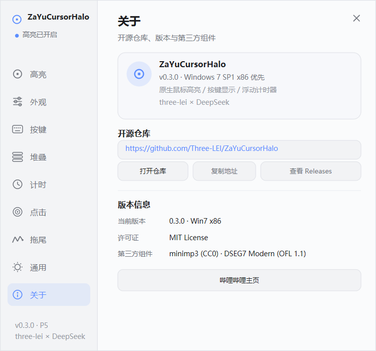

# P6 关于页

> 适用版本：ZaYuCursorHalo v0.3.0  
> exe：847,872 B

## 内容

- 程序名称、版本和 Win7 x86 定位；
- 开源仓库完整地址；
- “打开仓库”“复制地址”“查看 Releases”三个操作；
- 当前版本、许可证、第三方组件；
- 底部哔哩哔哩主页按钮，不展示具体网址。

## 操作

- **打开仓库**：用默认浏览器打开  
  `https://github.com/Three-LEI/ZaYuCursorHalo`
- **复制地址**：把仓库 URL 写入剪贴板；
- **查看 Releases**：打开  
  `https://github.com/Three-LEI/ZaYuCursorHalo/releases`
- **哔哩哔哩主页**：点击按钮打开作者主页，页面不显示具体网址

## 信息

- 项目：MIT License
- minimp3：CC0 1.0
- DSEG7 Modern：SIL OFL 1.1
